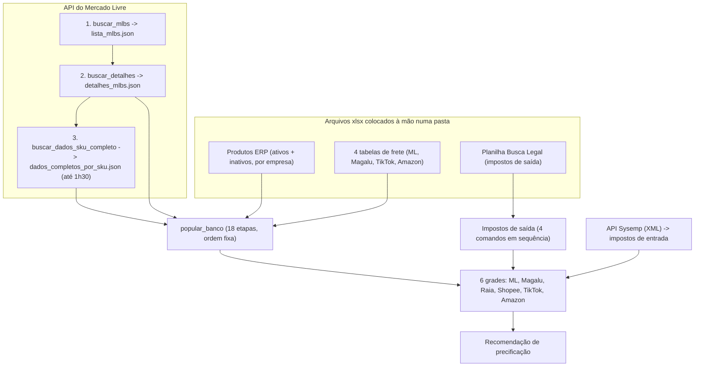

# Checkpoint - Rotina Vira Botão: Auditoria Ponta a Ponta e Mapa de Execução (14/10/2026)

## Última atualização

**16/10/2026 18:38** — Registro retroativo no vault. Entre 14 e 16/10 foram construídas, **sem anotar aqui na hora**, partes desta frente por telas próprias e em ciclos pequenos: a tela **Arquivos de referência** (Grupo A, e o começo prático da Fase 3), a tela **Gestão de APIs** (Grupo F, conexões) e o **hub de Configurações**. Pelo que está registrado, a **Fase 0 (Registro de Execuções e Executor) e a Fase 1 (botões das grades) continuam sem código**, e o recálculo automático das grades afetadas ainda não foi feito. A **decisão 4 da seção 8 foi respondida** (Google Drive, sempre 1 cópia). As outras 7 decisões seguem sem resposta registrada. O resumo do que foi feito está na seção "Atualização de 16/10/2026" logo abaixo; a análise das seções 1 a 9 continua como foi escrita em 14/10 (não foi reescrita). A entrega original de 14/10 08:56 está na Linha do tempo.

## Resumo do estado atual

O sistema ainda **não é autossuficiente sem o terminal**: a cadeia diária que abastece o banco e calcula as grades de precificação (ERP → Mercado Livre → impostos → grades) só roda por comandos de linha de comando, sem tela, sem ordem visível, sem memória do que já rodou e sem aviso de "está desatualizado". Esta nota guarda a análise completa (micro-problemas, soluções, visão macro, fluxo de uso, robustez) e o **mapa de execução em 7 fases**, para ser resolvido aos poucos, em ciclos curtos com confirmação antes de cada passo.

> [!warning] Status: em_andamento
> Análise entregue; **Fase 0 (fundação) ainda não iniciada**. Em paralelo, partes do Grupo A, do Grupo F e da Fase 3 foram entregues por telas próprias (ver "Atualização de 16/10/2026"). Aguardando feedback de Matheus sobre as decisões restantes da seção "Decisões que são de Matheus".

## Atualização de 16/10/2026: o que foi construído entre 14 e 16/10 (registro retroativo)

**O QUÊ**: depois da auditoria de 14/10, Matheus e Claude não seguiram o mapa de 7 fases na ordem desenhada. Foram construindo, tela por tela e em ciclos pequenos (idealizar, entregar, ele testar de verdade), as partes que mais doíam. Isto aconteceu **sem anotar no vault**; esta seção conserta o buraco.

**POR QUÊ importa**: quem ler só a análise acima vai achar que nada foi feito ("nenhuma fase iniciada"). Na prática, a entrada de arquivos e a gestão de conexões já viraram tela.

| Parte do mapa | O que foi entregue | Estado em 16/10/2026 | Nota com o detalhe |
|---|---|---|---|
| Grupo A, começo da Fase 3 (entrada de arquivos) | Tela **Arquivos de referência**: os 6 arquivos (4 de frete, 2 da Busca Legal) ficam no Google Drive; auditoria completa antes do envio; envio ao Drive; "Ver arquivo"; "Baixar"; botão "Atualizar o sistema com o Drive", só da empresa selecionada | Frete validado nas 2 empresas; Busca Legal (Expandir e Substituir) entregue, **aguarda teste real** | [[Checkpoint - Tela Arquivos de Referencia (14-10 a 16-10-2026)]], [[Checkpoint - Busca Legal no Botao Atualizar - Expandir e Substituir (16-10-2026)]] |
| Grupo F, começo da Fase 5 (conexões) | Tela **Gestão de APIs**: 7 conexões, teste de 1 chamada, resposta real em "Ver detalhes", Google Drive renovável por botão | Mercado Livre e Sysemp da Magazine, Claude e Agente testados ("Funcionando"); Drive renovado até 22/10/2026; faltam ML e Sysemp da Samvale e "Testar todas". O botão **Reconectar do Mercado Livre ainda não existe** (depende do domínio) | [[Checkpoint - Tela Gestao de APIs (14-10 a 16-10-2026)]] |
| Navegação | **Hub de Configurações** na tela inicial (antes "Em breve"), de onde abrem as duas telas acima | Entregue, **aguarda conferência de Matheus** | [[Checkpoint - Hub de Configuracoes (16-10-2026)]] |

**O que isto muda neste mapa (leitura rápida)**

- **Decisão 4 (onde guardar os xlsx): respondida em 14/10.** Google Drive, sempre 1 cópia (cada envio substitui o anterior). Isto troca a recomendação original ("pasta fora do código na VM, últimas 5"). Ver [[Decisao - Fluxo em Duas Etapas e Uma Unica Copia no Drive]].
- **Fase 3 começou na prática, só para a entrada de arquivos.** O botão "Atualizar" da Busca Legal já roda a cadeia de 4 passos dos impostos de saída, em dois modos: Expandir (nunca apaga) e Substituir (sistema igual à planilha, com prévia e confirmação). O arquivo de produtos do ERP **não** entrou: continua pela pasta, via `popular_banco`.
- **Fases 0 e 1 não têm registro de código.** As telas novas têm histórico próprio (`AtualizacaoDoSistema` por empresa na tela de arquivos; `EventoIntegracao` na Gestão de APIs), não o Registro de Execuções nem o Executor desenhados aqui. Os botões de recálculo das grades (por produto, por marketplace, tudo) não existem. O ponto onde esta frente e a Fase 1 se encontram é o **recálculo automático das grades afetadas**, decidido em 15/10 e ainda não feito. Hoje o botão apenas **avisa** quando uma grade ficou com preço da tabela anterior.
- **Decisão 3 (perfis de acesso)**: na Gestão de APIs, Matheus decidiu em 14/10 **não travar por usuário por ora**; permissões ficam para uma frente própria. Ver [[Decisao - Gestao de APIs Mostra So a Empresa Ativa e Uma Conexao Por API]].
- **Regras novas de tela**, que valem para qualquer botão desta frente: [[Regra - O Maximo de Acoes Possiveis Sempre em Tela]] (a regra que originou os botões), [[Regra - Layout Fixo na Vertical e Fluido na Horizontal]] e [[Decisao - Telas Mostram e Alteram So a Empresa Selecionada]] (cada empresa age só no seu banco).
- **Contexto de trabalho**: o desenvolvimento passou a ser no PC de casa, mas o código novo, pelo que foi observado, foi entregue na pasta do outro computador (**a confirmar com Matheus**). Ver [[Dois Computadores de Trabalho - Casa e Escritorio]].

## 1. Por que esta frente existe (o gatilho)

### 1.1 O gatilho concreto: Frete Fornecedor

O campo `frete_cif_fob` do `Produto` foi renomeado para `frete_fornecedor` e ganhou um cartão **"Financeiro"** editável no painel do produto, pouco antes desta frente nascer (decisão em [[Decisao - Campo Frete do Fornecedor Sera Renomeado de frete_cif_fob para Frete Fornecedor e Vira Editavel na Tela]]). Depois de salvar, o próprio cartão avisa: *"Salvo. Vale nas grades após o recálculo."* — e **o único jeito de recalcular as grades é por comando de terminal**, por exemplo:

```bash
python manage.py calcular_todas_as_grades_precificacao --empresa=magazine
```

Ou seja: o usuário edita um dado na tela e depois depende de alguém (o DEV) digitar um comando para o resultado aparecer. Esse foi o estopim.

### 1.2 O que Matheus pediu (resumo fiel das palavras dele)

- Pediu primeiro que as **grades de precificação tenham botões próprios de recálculo, em granularidades diferentes** (por produto, por marketplace, tudo).
- Depois ampliou: a etapa de recálculo é **"crítica e problemática"**; o sistema **não é autossuficiente 100% sem o terminal**; quer uma **auditoria completa ponta a ponta** em que `buscar_mlbs`, `buscar_detalhes`, `buscar_dados_sku_completo` e o cálculo das grades virem **botões, respeitando a granularidade de cada um** ("cada comando tem uma função e um objetivo claro").
- Precisa pensar no **usuário leigo/comum**: tirar a responsabilidade de ter um **DEV por perto**; o sistema será **hospedado em nuvem e usado em produção** — *"não dá pra ficar refém de comandos"*.
- **Método pedido**: quebrar em micro-problemas agrupados → solução de cada um → pensar no macro (as soluções se alinham?) → UX flow → como o sistema deve se portar perante o usuário → robustez → entregar um **mapa de execução didático** dizendo **o que mudar e por quê**.

### 1.3 Este problema já foi mapeado duas vezes

Esta é a **terceira vez** que o mesmo problema aparece: 15/08/2026 e 27/09/2026 (ambas em [[Reducao de Comandos de Management e Rotina Vira Botao]]). Naquelas duas rodadas se decidiu **o quê** categorizar, mas quase nada foi aplicado — e o sistema cresceu por cima. Esta rodada muda o foco: não é só classificar comandos, é **desenhar o motor e a tela** que fazem a rotina deixar de depender do terminal.

## 2. O que existe hoje (fatos verificados no código em 14/10/2026)

### 2.1 Os três tipos de operação

| Tipo | O que é | Exemplos reais |
|---|---|---|
| **Já é botão** (iniciar/status/parar na tela) | Existe URL e tela com acompanhamento | Full estoque (`gestao_full/urls.py`: `estoque/varredura/iniciar`, `/status` e `/parar`), Full comparativo (`comparativo-estoque/coletar`), Vendas por período (`gestao_vendas/urls.py`: `periodo/iniciar`, `/status` e `/parar`), Características (`mercado_livre/urls.py`: `caracteristicas/varredura/iniciar` e `/status`), Agenda de Vídeos (postagem, replicação, verificação, portal Drive), cálculo de frete por marketplace e ICMS/PIS por NCM |
| **Só terminal, mas é rotina** (o problema real) | Comando de management que o negócio precisa rodar de novo e de novo | `buscar_mlbs`, `buscar_detalhes`, `buscar_dados_sku_completo`, os 6 `calcular_grade_precificacao_*`, `popular_banco`, `sincronizar_impostos_entrada` |
| **Terminal legítimo** | Roda uma vez por ambiente, ou é contingência, ou é ferramenta de dev | `iniciar_banco`, `migrate`, `resetar_agenda_videos`, `investigar_campos_api` |

> [!info] Conclusão do diagnóstico
> O problema **não são "30 comandos soltos"**. É que a cadeia diária de dados não tem tela, ordem visível, memória do que já rodou nem aviso de desatualização.

### 2.2 A cadeia atual, na ordem em que acontece

O `popular_banco` (arquivo `core/management/commands/popular_banco.py`) tem **18 etapas ativas** em ordem fixa (a de Promoções ML está comentada/desligada desde 15/08):



As 18 etapas, na ordem: Produtos ERP, Anúncios ML, Indicadores Agenda, Dimensões Declaradas ML, Qualidade, Competição, Frete ML, Frete Magalu, Frete TikTok, Frete Amazon, Dimensão de Envio, Grade ML, Grade Magalu, Grade Raia, Grade Shopee, Grade TikTok, Grade Amazon, Recomendação Precificação. **Impostos (entrada e saída) não estão nessa lista** — rodam à parte.

### 2.3 De onde vêm os dados de entrada hoje

| Entrada | Onde fica | Como chega lá | Arquivo que lê |
|---|---|---|---|
| Produtos do ERP (ativos e inativos, por empresa) | `Arquivos usados para Popular Banco/Produtos ERP/*.xlsx` | Alguém exporta do ERP e coloca na pasta | `core/management/commands/popular_banco_suporte/importar_produtos_erp.py` (`CAMINHOS_ERP_POR_EMPRESA`) |
| 4 tabelas de frete | `Arquivos usados para Popular Banco/Tabelas de Frete/*.xlsx` (caminho **relativo**) | Idem | `importar_tabela_frete_ml.py`, `_magalu.py`, `_tiktok.py`, `_amazon.py` |
| Lista, detalhes e dados por SKU do ML | `integracao_mercado_livre/Arquivos_API/<Magazine ou Samvale>/*.json` | Gerados pelos 3 comandos de coleta | `integracao_mercado_livre/servicos/buscar_mlbs.py`, `buscar_detalhes.py`, `buscar_dados_sku_completo.py` |
| Impostos de saída (Busca Legal) | Planilha lida por 4 comandos | Colocada à mão | `impostos/management/commands/*` |
| Impostos de entrada | API do Sysemp (XML), com watermark | Comando `sincronizar_impostos_entrada` | `integracao_sysemp/servicos/orquestrador.py` |

### 2.4 Fatos de robustez encontrados no código

| Fato | Onde está | Consequência prática |
|---|---|---|
| O estado dos jobs com botão fica no **cache em memória de cada processo** (o `settings.py` não define `CACHES`, então o Django usa o padrão local por processo) | `projeto_sistema_interno_mb_sv/settings.py` (sem `CACHES`); `gestao_full/funcoes_auxiliares/full_estoque_varredura.py` usa `cache.add/set/get` | Em produção com **vários workers** do servidor, a tela de status pode cair em outro processo e dizer "nada rodando" |
| O job roda como **thread dentro do servidor web** (`threading.Thread(..., daemon=True)`) | `full_estoque_varredura.py`, linha 118 | Reiniciar o servidor (deploy; ou o autoreload do `runserver` ao salvar `.py`) **mata o job no meio**, sem aviso |
| Existe parada por inatividade (300 s sem progresso) e trava com `cache.add` | `full_estoque_varredura.py`, linhas 33 e 75 | Padrão bom e já provado — é a base do motor proposto |
| Os JSON de ponte são gravados **direto** (`open(caminho, "w")` + `json.dump`) | `buscar_mlbs.py` (linhas 314-315), `buscar_detalhes.py` (linhas 393-394) | Se o processo morrer no meio da escrita, o arquivo fica corrompido |
| As 6 calculadoras de grade leem **o catálogo inteiro** (`Produto.objects.all()`), sem filtro de produto | `precificacao/funcoes_auxiliares/{amazon,magalu,mercado_livre,raia,shopee,tiktok}/calcular_grade_precificacao_*.py` (ex.: ML linha 328) | Não existe "recalcular só este produto" |
| A grade ML usa a **API do ML** (frete real) dentro do cálculo | `calcular_grade_precificacao_ml.py` (ThreadPoolExecutor) | Mais lenta e com custo de chamadas de API |
| 5 calculadoras ligam `connection.force_debug_cursor = True` (diagnóstico de queries) | `calcular_grade_precificacao_{tiktok,shopee,raia,magalu,amazon}.py` | Ferramenta de dev dentro de código de produção — avaliar ligar só em modo dev ao expor em botão |
| `calculado_em` da grade guarda só a **data de criação** (não muda no recálculo) | modelo `GradePrecificacaoML` | Não serve como "última vez que foi calculada" |
| Token do ML: guardado no `.env` (`MB_ACCESS_TOKEN`, `SV_ACCESS_TOKEN`…), renovação com **lock em arquivo por conta** (lock com mais de 15 s é tratado como órfão) | `api_mercado_livre/core/auth/gerenciador_token.py` | **Já é robusto** entre processos. O buraco é a **autorização inicial**, que é um script manual |
| Autorização inicial do ML: "roda manualmente, uma única vez" e abre o navegador | `api_mercado_livre/core/auth/autorizacao_inicial.py` | Se o refresh_token for revogado, só o DEV resolve, pelo terminal |
| Caminhos **relativos** (`Path('Arquivos usados para Popular Banco/...')`) | `importar_tabela_frete_*.py`, `importar_produtos_erp.py` | Só funciona se o terminal for aberto na raiz do projeto |

### 2.5 A granularidade já existe no código (só falta expor na tela)

| Comando | Granularidades que o código já suporta | Fonte |
|---|---|---|
| `buscar_mlbs` | Conta inteira (por empresa) | `buscar_mlbs.py` |
| `buscar_detalhes` | Tudo; **retoma** de onde parou se interrompido (`detalhes_progresso.json`); lotes de 20 MLBs por chamada (`TAMANHO_LOTE = 20`) | `buscar_detalhes.py` |
| `buscar_dados_sku_completo` | Base inteira com checkpoint (`dados_completos_progresso.json`, "pode levar 1h30+") **ou** `--skus` (só os informados, com merge no arquivo existente) | `buscar_dados_sku_completo.py` |
| `buscar_comissao_real_ml` | 3 níveis: universal, `--produto <sku>`, `--mlb <mlb>` | `buscar_comissao_real_ml.py` |
| `buscar_frete_real_ml` | Cada variação que aparece em pelo menos 1 linha de `GradePrecificacaoML` (**depende de a grade existir**) | `buscar_frete_real_ml.py` |
| `coletar_operacoes_full` | Por produto (`--produto`), continua de onde a última coleta parou, `--dias` | `coletar_operacoes_full.py` |
| `sincronizar_categorias_ml` | Tudo, pula se o MD5 do dump não mudou (`--forcar` reprocessa) | `sincronizar_categorias_ml.py` |
| `sincronizar_impostos_entrada` | Incremental por watermark | `integracao_sysemp/servicos/orquestrador.py` |
| 6× `calcular_grade_precificacao_*` | **Só catálogo inteiro** — este é o gargalo | `precificacao/funcoes_auxiliares/*` |

### 2.6 Infraestrutura decidida (contexto que pesa no desenho)

Decidido com Matheus em 09/10/2026: **1 VM pequena (e2-medium) no GCP em São Paulo, MySQL instalado na própria VM** (não banco gerenciado), disco SSD, fotos e arquivos pesados no Google Drive. Consequências para este desenho: os arquivos em disco persistem (a VM tem disco persistente), mas **o banco e o sistema dividem a mesma máquina pequena** — cálculo pesado não pode competir à vontade com quem está usando o sistema. Ver contexto em [[Hospedagem em Nuvem - GCP vs AWS]] e [[Infraestrutura do Zero - Mudanca de Planos e Dominio]].

## 3. Micro-problemas agrupados e a solução de cada um

### 3.0 Glossário rápido (termos que aparecem daqui para a frente)

| Termo | O que significa, em linguagem simples |
|---|---|
| **Thread em background** | Um "trabalhador" que roda uma tarefa demorada por trás, enquanto a tela continua livre. É o que permite clicar num botão e não ficar com o navegador travado esperando. |
| **Polling** | A tela perguntando ao servidor, a cada poucos segundos, "como está a tarefa?" (progresso, terminou, deu erro). |
| **Sinal de vida (heartbeat)** | Uma anotação que a tarefa em execução faz de tempos em tempos ("ainda estou viva, já fiz 400 de 1.000"). Se o sinal para, sabemos que a tarefa morreu. |
| **Trava (lock)** | Uma marca "tem alguém rodando isto agora" que impede duas execuções iguais ao mesmo tempo e uma atropelar a outra. |
| **Checkpoint (ponto de retomada)** | O ponto até onde a tarefa já chegou, guardado para continuar dali em vez de recomeçar do zero. |
| **Gravação atômica** | Escrever num arquivo temporário e só no final trocar pelo definitivo, para nunca existir um arquivo "pela metade". |
| **Granularidade** | O tamanho da fatia que o botão atualiza: tudo, um marketplace, um produto, um único anúncio (MLB). |
| **Escopo** | A lista exata do que a tarefa vai tocar naquela execução (ex.: "só o SKU K-430"). |

### Grupo A — Entrada de arquivos (ERP, tabelas de frete, Busca Legal)

**Problemas**

- Os arquivos xlsx precisam estar numa pasta fixa dentro do projeto, com caminho **relativo** (só funciona se o terminal abrir na raiz).
- Alguém precisa ter acesso ao servidor só para colocar o arquivo lá.
- Nada avisa se o arquivo está velho, trocado ou com as colunas erradas — o erro só estoura no meio da importação.

**Solução proposta**: uma tela **"Enviar arquivo"**, por tipo e por empresa. O sistema valida colunas e empresa, mostra uma **prévia** ("1.012 produtos: 8 novos, 41 alterados, 3 saíram"), Matheus (ou o usuário) confirma, e só então importa. Guarda as últimas versões enviadas (quem e quando). **Continua humano**: alguém exportar o xlsx do ERP, até existir API do ERP — o botão só tira o DEV do meio.

### Grupo B — Coleta no Mercado Livre (API)

**Problemas**

- Os 3 passos são **encadeados e invisíveis**: `buscar_detalhes` exige a lista de MLBs; `buscar_dados_sku_completo` exige os detalhes. Hoje, se faltar a etapa anterior, o erro sai técnico (`RuntimeError` em `buscar_detalhes.py`, linha 215).
- São **demorados** (Dados por SKU leva até 1h30) → precisam rodar em segundo plano, com progresso e retomada.
- A granularidade é desigual (ver tabela 2.5).
- Regra de Matheus para API do ML: **mínimo de chamadas**, escala de ~1.000 SKUs, nunca chamada por pedido/por item, só com clique explícito.

**Solução proposta**

- Cada passo vira um **botão com menu de escopo**: *Conta inteira / Só o que mudou ou faltou / Um produto (SKU) / Um MLB* — onde o código já suporta.
- **Modal de confirmação** com estimativa em linguagem simples: "~N consultas ao ML, ~X min, você pode sair da tela" (estimativa calculada a partir de contagens que o sistema já tem — por exemplo, MLBs ÷ 20 por lote no `buscar_detalhes`).
- Na tela do produto: **"Atualizar dados deste produto no ML"**.
- Um botão composto **"Atualizar dados do ML"** encadeia 1 → 2 → 3 na ordem certa.
- **Pré-checagem em português**: "Falta buscar a lista de anúncios. [Buscar agora]" no lugar do erro técnico.

### Grupo C — Cálculo das grades (a etapa crítica)

**Problemas**

1. Só existe "recalcular o catálogo inteiro" (`Produto.objects.all()` nas 6 calculadoras), sem filtro de produto.
2. A grade ML depende da API (frete real) → mais lenta e com custo.
3. **Risco de corrida**: o lote tira uma "foto" dos dados no início; se enquanto ele roda alguém recalcular 1 produto, o lote pode **sobrescrever o resultado mais novo com um mais antigo** ao gravar no fim (`bulk_create`/`bulk_update`).
4. **Ninguém sabe se a grade está desatualizada.** Se mudou o Frete Fornecedor, o ERP ou um imposto, a grade antiga parece normal. É **risco financeiro** (preço errado em produção).
5. `calculado_em` guarda só a data de criação — não serve como "última vez calculada".

**Exemplo concreto**: Matheus altera o Frete Fornecedor de um produto de 3% para 5% no painel. As grades de todos os marketplaces desse produto continuam com o custo antigo até alguém rodar o comando. Hoje nada na tela diz isso.

**Solução proposta**

- As calculadoras passam a aceitar um **escopo** (todos ou uma lista de produtos) — é a base de todos os botões.
- Botões em **3 níveis**: **Produto** (no cabeçalho do cartão da grade e no painel do produto, logo depois de salvar o frete), **Marketplace** (cabeçalho da grade) e **Tudo** (na Central de Atualizações).
- **Uma trava por empresa**: lote e recálculo de produto não rodam ao mesmo tempo; o botão do produto explica "aguarde o recálculo geral". Elimina a corrida.
- **Selo honesto de frescor**: compara "quando a grade foi calculada" (vem do Registro de Execuções, ver Grupo E) com "quando a origem mudou por último" (importação do ERP, impostos, frete) → *Em dia* ou *Desatualizada*. Para 1 produto, marca "desatualizada" nos caminhos que controlamos (ex.: salvar o Frete Fornecedor).
- **ML pede confirmação** (usa API). Os outros 5 marketplaces são cálculo local → botão direto.
- Avaliar ligar o `force_debug_cursor` só em modo dev (5 calculadoras).

### Grupo D — Ordem e dependência

**Problema**: a ordem correta só existe na cabeça do dev e dentro do `popular_banco`. Fora dele é fácil rodar fora de ordem (ex.: grade antes do frete; `buscar_frete_real_ml` antes de a grade existir).

**Solução proposta**: um **mapa de dependências único** (quem depende de quem). A tela usa esse mapa para avisar ou bloquear e para oferecer **"Atualizar tudo"** e **"Atualizar a partir daqui"** (recalcula só o que depende do que mudou). As **etapas internas** (Qualidade, Competição, Dimensão de envio, Indicadores da agenda) **não viram botão**: rodam sozinhas depois da fonte delas — o usuário leigo não precisa saber que existem.

### Grupo E — Motor de execução (robustez)

**Problemas** (ver tabela 2.4): estado do job no cache de cada processo; thread dentro do servidor morre ao reiniciar; JSON gravado direto; saída só no console/log; e cada tela provavelmente repete o mesmo controle de iniciar/status/parar, trava e propagação da empresa na thread (**confirmar na Fase 0** se compartilham código base).

**Solução proposta**

- **Registro de Execuções** no banco: um "caderno" onde cada tarefa anota quem rodou, o quê, escopo, início e fim, status, progresso, resumo e erro **em português**, e o sinal de vida. Sobrevive a reinício e a vários workers; vira **histórico/auditoria**.
- **Executor único**, reaproveitando o padrão já provado do Full (thread + parar + empresa propagada com `definir_empresa_ativa(empresa)` como primeira linha da thread — ver [[Thread em Background Nao Herda a Empresa Ativa do EmpresaMiddleware (Threading Local)]]). **A Regra dos Três já foi atingida**: há pelo menos 8 telas com "iniciar/status" (Full estoque, Full comparativo, Vendas por período, Características e 4 da Agenda de Vídeos).
- Tarefa **sem sinal de vida** por X minutos vira **"Interrompida"**, com botão **Retomar** onde existe checkpoint.
- **Trava no banco**: 1 execução ativa por empresa e área, com limite de tarefas pesadas simultâneas (a VM é pequena e o banco divide a máquina).
- **Gravação atômica** dos JSON de ponte.
- **Sem Celery nem Redis**: o MySQL já está na VM.

### Grupo F — Conexões e acesso

- **Token do ML**: a renovação automática já é segura (lock em arquivo por conta). O buraco é o dia em que o `refresh_token` for revogado: a reautorização é um script manual de terminal com navegador. Precisamos de uma tela **"Conexão com o Mercado Livre"** (status, última renovação, botão **Reconectar**). Depende do **endereço definitivo do site** (o redirect precisa estar registrado no app do ML) — alinha com a fase de domínio/hospedagem.
- **Quem pode clicar o quê**: botões globais e pesados ("Recalcular tudo", "Conta inteira") devem ter **perfil de acesso**; botões de 1 produto ficam abertos. **A verificar**: como está o controle de perfis hoje.

## 4. Visão macro: as soluções se alinham?

**Sim**, desde que todas cresçam sobre **3 peças comuns** — o resto é tela por cima delas:

| Peça | Função | Analogia |
|---|---|---|
| **Registro de Execuções** | Memória: o que rodou, quando, por quem, com que resultado | Um caderno de ocorrências |
| **Executor** | Motor: roda em segundo plano, com trava, parar, retomar, empresa certa | Um funcionário que executa a tarefa e anota no caderno |
| **Mapa de dependências** | Ordem: o que depende do quê | O fluxograma do processo |

### 4.1 Conflitos entre as soluções e como cada um foi resolvido

| Conflito | Resolução |
|---|---|
| Botão por produto × lote geral (corrida) | **Trava única** por empresa e área |
| "Atualizar tudo" confortável × regra de mínimo de chamadas à API | Sempre com **estimativa + confirmação**, nunca automático, **incremental** por padrão |
| Mostrar "calculado em" × decisão anterior de deixar `calculado_em` como está | O frescor mora no **Registro de Execuções** (nível de lote); `calculado_em` por produto só se Matheus quiser |
| Robustez × "não reescrever o que funciona" | Os JSON continuam como ponte entre etapas (funcionam no disco persistente da VM); só ganham **gravação atômica**. Mover isso para o banco = fase futura |
| "Sem Celery" × robustez | O motor é **banco + thread**. Se a VM apertar, troca-se por um processo "worker" separado **sem mudar nenhuma tela** |
| Comandos de terminal × botões | Os comandos **não são apagados**: viram contingência/dev e usam o **mesmo código** dos botões (uma implementação, duas portas) |

## 5. Destino proposto de cada comando (reconciliação com as 4 categorias do vault)

As 4 categorias vêm de [[Reducao de Comandos de Management e Rotina Vira Botao]]: (1) Setup único, (2) Rotina real → botão, (3) Contingência → fica CLI, (4) Interno/dev.

| Destino | Comandos |
|---|---|
| **Viram botão** (categoria 2) | `buscar_mlbs`, `buscar_detalhes`, `buscar_dados_sku_completo`, `buscar_comissao_real_ml`, `buscar_frete_real_ml`, `coletar_operacoes_full`, `sincronizar_categorias_ml`, os 6 `calcular_grade_precificacao_*` (+ `calcular_todas_as_grades_precificacao`), `sincronizar_impostos_entrada`, `Sincronizar_Impostos_de_Saida` (e os 4 passos dele), `popular_banco` (vira **"Atualizar tudo"**, ver tensão abaixo) |
| **Viram etapa automática interna** | `organizar_e_verificar_divergencias_dimensoes_envio`, `sincronizar_indicadores_agenda` |
| **Ficam no terminal** (categorias 1, 3 e 4) | `iniciar_banco`, `migrate`, `resetar_agenda_videos`, `reprocessar_impostos_entrada_de_json`, `reprocessar_impostos_entrada_do_bruto`, `verificar_retratos_impostos_entrada`, `investigar_campos_api` |
| **Relatórios só leitura** | `gerar_relatorio_divergencia_dimensao_envio`, `gerar_relatorio_frete_erp_vs_ml` — candidatos a botão "Exportar" (já existe o padrão de exportação com token em `precificacao/views/exportacao_precos.py`); prioridade baixa |
| **A avaliar** | `validar_classificacao` (não foi lido a fundo; no vault consta como "indefinido/abandonado") |

> [!warning] Tensão com uma decisão anterior do vault — decisão em aberto de Matheus
> Em 15/08/2026 ficou registrado, "confirmado pelo usuário com 100% de certeza", que **`iniciar_banco` e `popular_banco` seguem CLI** (usados uma única vez por ambiente) — ver [[Reducao de Comandos de Management e Rotina Vira Botao]]. A análise de 14/10 propõe o contrário para o `popular_banco`: virar o botão **"Atualizar tudo"**, porque ele contém etapas de rotina diária (importar ERP, fretes, recalcular grades) e já foi rodado várias vezes (ex.: reconstrução de 27/09). **Esta nota não revoga a decisão de 15/08**; registra a divergência para Matheus decidir. Opção intermediária possível: `popular_banco` continua CLI (setup/reconstrução) e o botão "Atualizar tudo" executa **as mesmas etapas de rotina** pelo Executor.

## 6. UX flow e como o sistema deve se portar

### 6.1 Peça central: "Central de Atualizações" (nome a definir por Matheus)

Um **cartão por assunto**, na linguagem do negócio (nunca nome de comando). Cada cartão traz: nome e 1 linha do que faz; **"Atualizado em dd/mm hh:mm (por quem)"**; um **selo** (Em dia, Desatualizado, Rodando, Falhou, Nunca rodou); o **botão com menu de escopo**; e "o que isso afeta". Além da Central, **atalhos contextuais** nas telas onde o usuário já está (grade, painel do produto).

### 6.2 Quatro jornadas

| Jornada | Passo a passo |
|---|---|
| **Rotina do dia (gestor)** | Abre a Central → vê 2 cartões amarelos → "Atualizar o que está desatualizado" → modal mostra o que vai rodar, em que ordem, quantas consultas ao ML e quanto tempo → confirma → acompanha ou sai |
| **Mudei 1 dado de 1 produto (operador)** | Salva o Frete Fornecedor → aviso inline "Grades deste produto desatualizadas. [Recalcular]" → 1 clique → resultado aparece no lugar |
| **Algo falhou** | Mensagem em português + próximo passo + [Tentar de novo / Retomar]; detalhe técnico recolhido, para o dev |
| **Voltei depois de 1h** | Indicador fixo "Tarefas em andamento (1)" abre progresso e histórico; fica num **slot fixo** que não move o layout (regra de layout fixo de Matheus de 12/10) |

### 6.3 As regras de comportamento do sistema

1. **Nunca age em silêncio**: diz o que está fazendo e quando terminou.
2. **Antes de gastar API ou tempo, diz o custo e pede confirmação.**
3. **Não deixa clicar duas vezes nem em conflito**, e o botão explica por que está bloqueado.
4. **Nunca perde progresso**: retoma de onde parou.
5. **Nunca deixa nada pela metade**: grava no fim, de forma atômica.
6. **Fala a língua do negócio** (SKU, MLB e grade, sim; varredura, snapshot e checkpoint, não).
7. **Todo erro diz o que houve e o que fazer.**
8. **Layout fixo e largura aproveitada** (regras de 12/10/2026).

## 7. Mapa de execução por fases (o que mudar e por quê)

Cada fase é pequena, termina utilizável e segue o ciclo Idealizar → Planejar → **confirmar** → Executar. **Nenhuma está iniciada.** *(Atualização de 16/10/2026: partes da Fase 3, entrada de arquivos, e da Fase 5, status das conexões, foram entregues por telas próprias, fora deste desenho; ver "Atualização de 16/10/2026".)*

| Fase | O que muda | Por quê |
|---|---|---|
| **0. Fundação** | Registro de Execuções (model + migration, que Matheus roda), Executor, trava, gravação atômica dos JSON | Tudo depende disso; sem isso, cada botão copia o padrão frágil de hoje |
| **1. Grades** | Escopo nas 6 calculadoras; botões produto/marketplace/tudo; selo de frescor; Central nascendo só com os cartões de grade | É a dor de hoje e o maior impacto financeiro; resolve o fluxo do Frete Fornecedor |
| **2. Coleta ML** | MLBs, Detalhes, Dados por SKU, categorias, comissão real, frete real e operações Full como botões com escopo + "Atualizar dados do ML" | Elimina o terminal na cadeia da API |
| **3. Arquivos e impostos** | Upload com validação e prévia (ERP, 4 fretes, Busca Legal); cadeia de 4 passos dos impostos de saída em 1 botão; impostos de entrada (Sysemp) | Tira o DEV do meio da entrada de dados |
| **4. Fecho da Central** | "Atualizar tudo" guiado pelo mapa de dependências; indicador global de tarefas; histórico | Dá ao usuário leigo um único ponto de partida |
| **5. Conexão ML na tela** | Status do token e botão Reconectar | Fecha o último buraco de terminal; depende do domínio |
| **6. Arrumação** | Reclassificar comandos nas 4 categorias, atualizar inventário e notas, agendamento noturno opcional no mesmo Executor | Deixa a documentação igual à realidade |

**Ordem recomendada**: 0 → 1 → 2 → 3 → 4 (a 5 entra quando o domínio estiver pronto; a 6 no fim).

**Primeiro passo concreto proposto (piloto)**: Registro + Executor com **um único botão "Recalcular grade Magalu"** — marketplace local, **sem API**, o mais seguro. Valida o motor ponta a ponta antes de tocar no ML. Antes de escrever qualquer `.py`, Claude avisa (o autoreload do `runserver` derruba threads em andamento) e só escreve com nenhuma tarefa rodando.

## 8. Decisões que são de Matheus (com a recomendação de Claude)

| # | Decisão | Recomendação de Claude | Status |
|---|---|---|---|
| 1 | Motor: thread no servidor + estado no banco, ou processo worker separado | Thread + banco agora (worker separado é mais uma peça de infra para operar; revisar quando a VM apertar) | Aguardando |
| 2 | Ao salvar o Frete Fornecedor: só avisar e oferecer o botão, ou recalcular sozinho | Só avisar + botão (o ML usa API; regra do clique explícito) | Aguardando |
| 3 | Perfis: quem pode "Recalcular tudo" e "Conta inteira" | Restringir os globais; 1 produto aberto | Aguardando |
| 4 | Onde guardar os xlsx enviados e quantas versões | Pasta fora do código na VM, últimas 5; cópia no Drive só se ele quiser | **Respondida em 14/10:** Google Drive, 1 cópia (ver "Atualização de 16/10/2026") |
| 5 | "Atualizar tudo" inclui as etapas de API? | Sim, sempre com estimativa e clique | Aguardando |
| 6 | Nome e lugar da Central no menu | — (escolha dele) | Aguardando |
| 7 | Aprovar o piloto com a Magalu | Sim, como primeiro ciclo | Aguardando |
| 8 | `popular_banco`: continua só CLI (decisão de 15/08) ou vira "Atualizar tudo" | Opção intermediária da seção 5 | Aguardando |

## 9. O que se decidiu deliberadamente NÃO fazer

- **Celery ou Redis** (o MySQL na VM já basta para estado de tarefas).
- **Reescrever a ponte em JSON para o banco agora** (funciona; vira fase futura).
- **Chamar a API automaticamente ao abrir uma tela** (regra de mínimo de chamadas).
- **Apagar os comandos de terminal** (viram contingência/dev).

## Linha do tempo

### 14/10/2026 08:56 — Auditoria entregue e registrada

- Claude leu o código real (comandos de management, serviços de coleta do ML, URLs de todos os apps, `settings.py`, gerenciador de token do ML, referência do Full), as notas do vault sobre comandos e a infraestrutura decidida.
- Entregou a análise em chat; Matheus pediu que fosse **salva no vault** porque vai dar feedback aos poucos e resolver por partes, sem perder a análise. Esta nota é esse registro.
- Correção feita no caminho: o `popular_banco` tem **18 etapas ativas** (Claude havia dito 20 por engano durante a conversa).
- **Divergência registrada**: o vault dizia que `popular_banco` "segue CLI"; a análise propõe "Atualizar tudo". Decisão fica com Matheus (item 8 das decisões).

### 14/10/2026 — Grupo A decidido e Gestão de APIs nasce (registro retroativo, escrito em 16/10 18:38)

- Matheus decidiu guardar os 6 arquivos de referência no Google Drive, sempre 1 cópia, em 2 etapas separadas (enviar, depois atualizar o sistema), com auditoria completa antes do envio. Isto respondeu a decisão 4 da seção 8. Ver [[Decisao - Fluxo em Duas Etapas e Uma Unica Copia no Drive]].
- Depois do erro `invalid_grant` do Google Drive, pediu uma tela para reativar permissões sem terminal. Nasceu a **Gestão de APIs**, gerada direto no sistema ("chega de mockups soltos"). Ver [[Checkpoint - Tela Gestao de APIs (14-10 a 16-10-2026)]].
- Da conversa saiu a regra "o máximo de ações possíveis sempre em tela" ([[Regra - O Maximo de Acoes Possiveis Sempre em Tela]]); o botão "Renovar autorização" do Drive foi o primeiro exemplo.

### 15/10/2026 — Tela Arquivos de Referência: auditoria, envio e primeiro "Atualizar" (retroativo)

- Matheus voltou a este plano (deixou a tela de Características de lado) e aprovou começar o Grupo A pela tela e pela auditoria do frete; depois a auditoria da Busca Legal; depois o envio ao Drive, validado nos 6 arquivos.
- Primeiro botão "Atualizar o sistema com o Drive" (só frete, 2 empresas): as 4 tabelas "Já estavam em dia"; a Samvale tinha 224 linhas de frete ML que o arquivo não tem ([[Descoberta - Samvale Tinha 224 Linhas de Frete ML Que o Arquivo Nao Tem]]).
- Decisões: o frete passa a espelhar o arquivo; datas nos cartões; as grades TikTok, Magalu e Amazon não mantêm preço antigo; as grades afetadas devem ser recalculadas automaticamente. Ver [[Decisao - Atualizar o Sistema Altera So a Empresa Ativa e o Frete Vira Espelho do Arquivo]]. O recálculo automático **ainda não foi feito**.

### 16/10/2026 — Independência por empresa, Ver arquivo, Baixar, Busca Legal e hub de Configurações (retroativo)

- Decidido que a tela mostra e altera só a empresa selecionada ([[Decisao - Telas Mostram e Alteram So a Empresa Selecionada]]). Entregues "Ver arquivo" e a independência; testados nas duas empresas (na Samvale saíram as 224 linhas).
- Busca Legal no botão: Expandir (ciclo 1) e Substituir na opção B (ciclo 2, com prévia e confirmação), mais o botão "Baixar" como backup. Ver [[Checkpoint - Busca Legal no Botao Atualizar - Expandir e Substituir (16-10-2026)]] e [[Decisao - Busca Legal ao Atualizar - Expandir ou Substituir (Opcao B)]]. Aguardam teste real.
- Hub de Configurações entregue ([[Checkpoint - Hub de Configuracoes (16-10-2026)]]).
- Matheus passou a trabalhar com Claude no PC de casa, usando o do escritório só para consulta ([[Dois Computadores de Trabalho - Casa e Escritorio]]), e informou os monitores de referência ([[Telas e Monitores dos Usuarios - Resolucoes de Referencia Para Desenhar o Sistema Interno V2]]).

### 16/10/2026 18:38 — Registro retroativo no vault

Matheus notou que "fizemos muita coisa sem anotar nada" e pediu para voltar a registrar. Foram escritas 15 notas (checkpoints, decisões, regras, descoberta, conceitos), o índice foi atualizado e esta nota foi revista. O que foi escrito vem do histórico do que Matheus relatou e do código da pasta do V2; itens que não deu para conferir estão marcados como "a confirmar" nas notas de cada tela.

## Em aberto

- [ ] Matheus dar feedback sobre as 8 decisões da seção 8.
- [ ] Aprovar (ou ajustar) o piloto da Fase 0 (Registro + Executor + botão Magalu).
- [ ] Resolver a divergência `popular_banco` CLI × "Atualizar tudo" (esta nota não revoga a decisão de 15/08).
- [ ] Confirmar na Fase 0 se as telas que já têm "iniciar/status" compartilham código base ou repetem o controle.
- [ ] Verificar como está o controle de perfis de acesso hoje (decisão 3).
- [ ] Definir o domínio/endereço definitivo antes da Fase 5 (redirect do OAuth do ML).
- [ ] Ligadas ao Frete Fornecedor (não são desta frente, mas dependem do terminal hoje): rodar `makemigrations` (responder `y` ao renomear `frete_cif_fob`) e `migrate` nos 2 bancos, e recalcular as grades das 2 empresas; remover depois o fallback de chave antiga em `precificacao/views/modal_comum.py`.
- [x] Decisão 4 da seção 8 (onde guardar os xlsx): respondida em 14/10/2026, Google Drive, sempre 1 cópia.
- [ ] Decisões 1, 2, 3, 5, 6, 7 e 8 da seção 8: sem resposta registrada (a 3 tem uma resposta parcial: sem trava por usuário na Gestão de APIs, por ora).
- [ ] Matheus testar de verdade, Magazine primeiro e depois Samvale: o **Expandir** (impostos), o **Substituir** da Busca Legal (abrir a prévia, ler e cancelar na primeira vez) e o **hub de Configurações**. Ver [[Checkpoint - Busca Legal no Botao Atualizar - Expandir e Substituir (16-10-2026)]] e [[Checkpoint - Hub de Configuracoes (16-10-2026)]].
- [ ] **Recálculo automático das grades afetadas**, só na empresa afetada (ciclos 3 e 4 do plano de 16/10). Decidido em 15/10, ainda não feito; é o encontro desta frente com a Fase 1.
- [ ] Gestão de APIs: renovar o Drive antes de **22/10/2026**; testar ML e Sysemp da Samvale e o "Testar todas"; a chave do Claude vence em 13/11/2026. Ver [[Checkpoint - Tela Gestao de APIs (14-10 a 16-10-2026)]].
- [ ] Levar o app `arquivos_referencia` para a pasta do V2 do PC de casa (commit e push no computador onde ele foi entregue, pull em casa; confirmar qual é). Ver [[Dois Computadores de Trabalho - Casa e Escritorio]].
- [ ] Definir o destino do **arquivo de produtos do ERP** (upload com validação e prévia): hoje entra pela pasta, via `popular_banco`, fora dos 6 arquivos do Drive.
- [ ] Quando uma fase for concluída, atualizar esta nota (linha do tempo + status) e a linha do índice.

## Relacionado

- [[Reducao de Comandos de Management e Rotina Vira Botao]]
- [[Redesenho do Popular Banco - Fontes de Dados e Escopo]]
- [[Reconstrucao Completa do Banco do Zero — Validacao de Ponta a Ponta Pos-Reforma OOP do Mercado Livre (27-09-2026)]]
- [[Barra de Progresso Real no Sincronizar com o Drive do Portal via Thread e Polling]]
- [[Thread em Background Nao Herda a Empresa Ativa do EmpresaMiddleware (Threading Local)]]
- [[Decisao - Fluxo de Impostos de Saida Passa a 4 Comandos Auto-Suficientes, CST Isolado em Comando Proprio Como Fonte Unica]]
- [[Decisao - Campo Frete do Fornecedor Sera Renomeado de frete_cif_fob para Frete Fornecedor e Vira Editavel na Tela]]
- [[Orquestracao da Sincronizacao de Impostos de Entrada via XML]]
- [[Sincronizacao Incremental com Watermark para Manifesto de Notas de Entrada]]
- [[Checkpoint - Frete Real da API Implementado (Tela, Banco de Dados e Comando de Coleta em Massa)]]
- [[Checkpoint - Investigação da Comissão Real de Venda via API do Mercado Livre]]
- [[Padrao de Robustez para Clientes de API Externa]]
- [[Hospedagem em Nuvem - GCP vs AWS]]
- [[Infraestrutura do Zero - Mudanca de Planos e Dominio]]
- [[Sistema Interno V2 e Produto Real - Padrao Maximo de Qualidade, Documentacao, Validacao e Resolucao Real do Cliente]]
- [[Checkpoint - Tela Gestao de APIs (14-10 a 16-10-2026)]]
- [[Checkpoint - Tela Arquivos de Referencia (14-10 a 16-10-2026)]]
- [[Checkpoint - Busca Legal no Botao Atualizar - Expandir e Substituir (16-10-2026)]]
- [[Checkpoint - Hub de Configuracoes (16-10-2026)]]
- [[Decisao - Fluxo em Duas Etapas e Uma Unica Copia no Drive]]
- [[Decisao - Atualizar o Sistema Altera So a Empresa Ativa e o Frete Vira Espelho do Arquivo]]
- [[Decisao - Busca Legal ao Atualizar - Expandir ou Substituir (Opcao B)]]
- [[Decisao - Gestao de APIs Mostra So a Empresa Ativa e Uma Conexao Por API]]
- [[Decisao - Google Drive em Modo Testando e Renovacao de 7 Dias Por Botao]]
- [[Decisao - Telas Mostram e Alteram So a Empresa Selecionada]]
- [[Descoberta - Samvale Tinha 224 Linhas de Frete ML Que o Arquivo Nao Tem]]
- [[Regra - O Maximo de Acoes Possiveis Sempre em Tela]]
- [[Regra - Layout Fixo na Vertical e Fluido na Horizontal]]
- [[Dois Computadores de Trabalho - Casa e Escritorio]]
- [[Telas e Monitores dos Usuarios - Resolucoes de Referencia Para Desenhar o Sistema Interno V2]]
