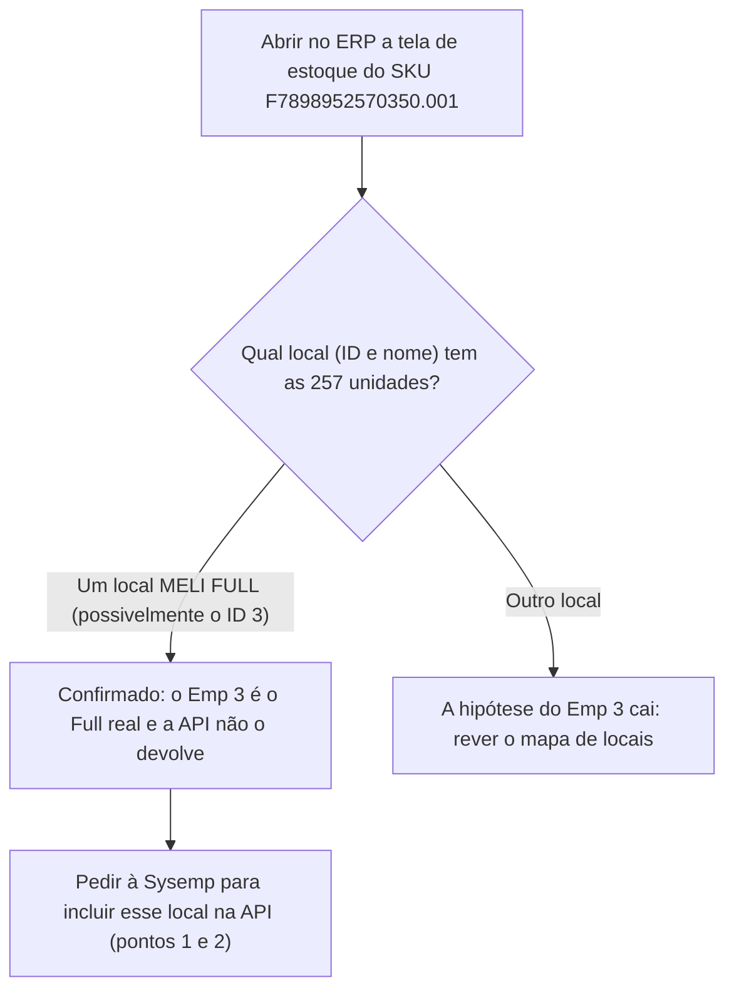

# API de Estoque do ERP (Sysemp) Precisa Ser Repensada e Alterada

**Resumo**: em 10/10/2026 (13:22) o usuário decidiu que a API do ERP (Sysemp) para estoque precisa ser repensada e alterada — o primeiro Excel do Comparativo de estoque (Samvale, 1.110 SKUs) mostrou que o "Full" da Sysemp (local id 4) tem 153 unidades contra 3.797 no Full do Mercado Livre, enquanto o Flex (ids 2 + 10) bate com o Mercado Livre em 91,9% dos SKUs.

> [!info] Status
> Decisão registrada em 10/10/2026 às 13:22 (`status: ativa`). **O que exatamente vai mudar na API ainda não foi definido** — esta nota registra a decisão e as evidências que levaram a ela. **Nada foi pedido à Sysemp ainda.** Os pontos candidatos e o próximo passo estão nas seções finais.

## Contexto

Termos usados nesta nota, explicados na primeira aparição:

| Termo | O que significa |
|---|---|
| **ERP / Sysemp** | O sistema de gestão da empresa, onde ficam cadastro de produto, nota fiscal e estoque. Sysemp é o nome do fornecedor desse ERP. |
| **API do ERP para estoque** | O método `listarAnaliseEstoqueFull` da Sysemp. Devolve uma linha por produto **e por local de estoque**, com a quantidade no campo `estoque`. Só existe na Samvale (instância `/84`); na Magazine a resposta é "Metodo não Localizado". Detalhes em [[listarAnaliseEstoqueFull - Estoque do ERP por local]]. |
| **Local de estoque (`id_empresa`)** | Cada lugar lógico do ERP onde o estoque de um produto pode estar. A API chama o número do local de `id_empresa`. |
| **Full** | Mercado Livre Fulfillment: o estoque fica guardado e despachado pelo próprio Mercado Livre. |
| **Flex** | Estoque que fica no depósito da própria Samvale, visto pelo Mercado Livre como "depósito do vendedor". |
| **SKU** | Código do produto. O padrão do projeto é a letra "F" + o EAN + ".001" (exemplo: `F7898952570350.001`). |
| **Código ML do Full** | Identificador do estoque de Full de um produto no Mercado Livre. Um mesmo SKU pode ter vários (nesta coleta, 71 SKUs têm mais de um). |
| **ML** | Abreviação de Mercado Livre. |

**Mapa de locais da Samvale**, como explicado pelo usuário em 08/10/2026 (fonte: [[listarAnaliseEstoqueFull - Estoque do ERP por local]]):

| id | Nome no ERP | O que é | Equivale no Mercado Livre |
|---|---|---|---|
| 4 | MELI FULL SAMVALE STEXPID | Controle do ERP do estoque que está no Full. Em teoria, sempre igual ao Full do Mercado Livre. | Full |
| 2 | SAMVALE | Onde os produtos ficam fisicamente quando não são Full. | Flex |
| 10 | DEPOSITO INDUSTRIAL SAMVALE | Igual ao id 2, mas em outro barracão físico. Independente do id 2. | Flex (2º barracão) |
| 1 | VSCOMERCIO | Empresa sem movimentação; não deveria ter estoque nenhum. | nada |

A tela **"Comparativo de estoque (debug)"** (app `gestao_full` do Sistema Interno V2) compara 3 fontes lado a lado: o **Arquivo** (a planilha de produtos do ERP, a mesma que alimenta o banco), a **API Sysemp** e a **API do Mercado Livre**. O objetivo dela, definido pelo usuário em 10/10/2026, é entender se os dados da API Sysemp são confiáveis e quais mudanças pedir à Sysemp. A expectativa registrada era API Sysemp igual (ou muito próxima) à API do Mercado Livre.

Em 10/10/2026 a tela ganhou o botão **Exportar Excel** (arquivo `gestao_full/funcoes_auxiliares/comparativo_estoque_exportacao.py`, função `gerar_excel_comparativo`), que baixa a lista inteira (não só a página) com as 3 fontes. O primeiro arquivo real foi `Comparativo_Estoque_Full_SAMVALE_10_10_26_1309.xlsx`.

## O problema / a pergunta

Os números de estoque que a API do ERP entrega são confiáveis para comparar com o Mercado Livre? E, se não forem, o que precisa mudar nela?

## O que levou à decisão

### 1. Em que condições o Excel foi gerado

| Fonte | Quando | Detalhe |
|---|---|---|
| Arquivo do ERP | modificado em 02/10/2026 às 08:02 (8 dias antes) | 890 SKUs; colunas de estoque: `Estoque`, `Estoque Emp 2`, `Estoque Emp 3`, `Estoque Emp 10`; 29 linhas sem SKU |
| API Sysemp | coletada em 10/10/2026 às 13:09 | Coleta completa (a API avisou que não havia mais linhas): 534 linhas em 6 páginas. Por local: id 4 = 51 linhas, id 2 = 426, id 10 = 54, id 1 = 3 |
| API Mercado Livre | consultas de 10/10/2026 entre 12:49 e 12:57 | 516 SKUs com Código ML do Full; 620 Códigos ML, todos consultados com sucesso. O Excel só lê o que já estava gravado no banco |

O Excel junta as 3 fontes e tem **1.110 SKUs** no total.

> [!warning] Diferença de horário entre as fontes
> O Mercado Livre foi consultado de 12 a 20 minutos antes da Sysemp, e o arquivo do ERP é de 8 dias antes. Diferenças de poucas unidades podem ser só movimento de estoque. As diferenças grandes descritas abaixo não se explicam por isso.

### 2. Full: Sysemp (id 4) contra Mercado Livre — o achado principal

| Medida | Resultado |
|---|---|
| Total no id 4 da Sysemp | 153 unidades, em 51 linhas |
| Total no Full do Mercado Livre | 3.797 unidades, em 110 SKUs |
| SKUs com Código ML do Full | 516 |
| SKUs "iguais" | 403 — **todos são 0 = 0** (nenhum tem estoque) |
| SKUs com estoque nos dois lados e o mesmo número | **0** |
| Mercado Livre tem Full e a Sysemp id 4 = 0 | 110 SKUs |
| Sysemp id 4 > 0 e Mercado Livre Full = 0 | 3 SKUs: `F7896615100029.001` (6 unidades), `F7898157301179.001` (1) e `F7898157302060.001` (1) |
| As 51 linhas do id 4 | 49 não estão no arquivo de ativos; 48 não têm Código ML no banco; 4 não têm SKU |

Os 403 "iguais" parecem bom resultado, mas são só produtos sem estoque nos dois lados. Nos produtos que realmente têm Full no Mercado Livre, a Sysemp id 4 não acompanha nenhum. **Interpretação** (não provada — ver "O que NÃO se sabe"): o id 4 parece guardar resíduo antigo, não o Full real.

### 3. Pista: a coluna "Estoque Emp 3" do arquivo

| Fato observado | Número |
|---|---|
| A coluna `Estoque` do arquivo é igual a `Estoque Emp 2` + `Estoque Emp 10` | 853 dos 890 SKUs |
| `Estoque Emp 2` igual ao id 2 da Sysemp | 756 SKUs |
| `Estoque Emp 10` igual ao id 10 da Sysemp | 855 SKUs |
| `Estoque Emp 3` (fica fora da coluna `Estoque`) | 4.485 unidades em 159 SKUs |
| Nos 384 SKUs que estão no arquivo e têm Código ML: soma de `Estoque Emp 3` contra soma do Full do Mercado Livre | 4.053 contra 3.797 |
| Correlação entre `Estoque Emp 3` e o Full do Mercado Livre (mesmos 384 SKUs) | 0,93 |
| SKUs com `Estoque Emp 3` e Full do Mercado Livre, ambos maiores que zero | 100; em 64 a diferença é de até 15% (48 deles exatamente iguais) |
| `Estoque Emp 3` > 0 e Full do Mercado Livre = 0 | 52 SKUs (187 unidades) |
| Full do Mercado Livre > 0 e `Estoque Emp 3` = 0 | 10 SKUs |

Leitura: o número depois de "Emp" parece ser o id do local (Emp 2 acompanha o id 2, Emp 10 acompanha o id 10). Se for, **o `Estoque Emp 3` é o local 3 do ERP** — e é ele, não o id 4, que acompanha o Full do Mercado Livre. **A API nunca devolveu um local 3**: só vieram os locais 1, 2, 4 e 10.

> [!warning] Revisão necessária na nota de 08/10
> A nota [[listarAnaliseEstoqueFull - Estoque do ERP por local]] classificou os locais 3, 7, 13, 14, 15 e 16 (e Farmácia Depósito 2) como "não relevantes", pelos nomes (quatro "MELI FULL ...", dois da Amazon e a Farmácia), sem registrar qual id tem qual nome. Esta nota mostra que o local 3 pode ser relevante. A classificação precisa ser revista.

### 4. Flex: Sysemp (ids 2 + 10) contra Mercado Livre — o que funciona

- Dos 516 SKUs com Código ML, **474 são iguais (91,9%)**; 42 diferem. Em 29 a Sysemp tem mais que o Mercado Livre (soma de 1.665 unidades) e em 13 o Mercado Livre tem mais.
- Oito dos 42 formam um padrão próprio (SKUs antigos da marca TAKECARE, cujo número no Mercado Livre acompanha o estoque do SKU novo na Sysemp). Parece ser questão de vínculo de SKU no anúncio, não da API de estoque; **fica fora desta nota** e não foi investigado.
- Sem esses 8: 508 SKUs, 474 iguais (93,3%). Dos 34 que diferem, 25 diferem em até 20 unidades e 9 em mais de 20.

Conclusão desta parte: o Flex da API bate com o Mercado Livre na grande maioria dos SKUs.

### 5. Arquivo contra Sysemp (Flex)

Dos 890 SKUs do arquivo, 729 são iguais a Sysemp ids 2 + 10 (81,9%). O total do arquivo é 21.440 unidades e o da Sysemp, nos mesmos SKUs, 21.273 (diferença de 0,8%) — coerente com os 8 dias de diferença entre as fontes.

### 6. Dados sujos vistos na Sysemp

| Achado | Detalhe |
|---|---|
| Linhas sem SKU (4, todas no id 4) | "MODELADOR CURVES 1 (INATIVO)" com 9 unidades; "AP PRESSAO OMRON HEM 7130" com 1; "AP PRESSAO OMRON HEM 7320" com 1; "CHAPA TITANIUM 450 BIV ACTION" com 6 |
| VSComercio (id 1) com estoque, mas não deveria ter | 3 SKUs, 7 unidades: `32003` (5), `F7895512692309.001` (1) e `F7895512692446.001` (1) |
| SKUs só na Sysemp (nem no arquivo, nem no Mercado Livre) | 88 SKUs; no id 2 somam 515 unidades, das quais 429 em 2 SKUs: Travesseiro antialérgico SONOBRAZ (332) e Fonte de alimentação veicular MD3000 (97) |
| SKUs só no Mercado Livre | 129 SKUs, todos com Full = 0; 14 com SKU fora do padrão (exemplos: `1827`, `7898157301322`, `BQTSECC01`) |

## O que NÃO se sabe

- **O que o id 4 é de fato hoje** no ERP (resíduo antigo? trânsito? outro uso?).
- **Se o `Estoque Emp 3` é mesmo o local 3 do ERP** e se esse local é um Full.
- **Se existem outros locais de Full** que a API não devolve (a nota de 08/10 cita quatro locais "MELI FULL ...").
- **O que significa o `estoque` da API** — a coluna "Estoque" ou a "Disponível" da tela do ERP (pendência já registrada em 08/10).
- **Se as diferenças de Flex acima de 20 unidades** são atraso do ERP ao atualizar o Mercado Livre ou outra causa.

## A decisão

> [!success] Decisão (10/10/2026, 13:22)
> A **API do ERP (Sysemp) para estoque precisa ser repensada e sofrer alterações.** Decisão do usuário, tomada depois de ver a análise do primeiro Excel do Comparativo de estoque.

Esta nota ainda **não define quais alterações**. A tabela abaixo lista os **pontos candidatos** para levar à Sysemp — nenhum foi pedido ainda, e os três primeiros dependem do próximo passo.

| # | Ponto candidato | De onde vem |
|---|---|---|
| 1 | Por que a API só devolve os locais 1, 2, 4 e 10 | Excel de 10/10 (534 linhas, 4 locais) contra a coluna `Estoque Emp 3` do arquivo |
| 2 | Incluir na API o local que guarda o Full real (a confirmar qual é) | Mesma evidência do ponto 1 |
| 3 | O que o id 4 representa hoje | 51 linhas, 49 fora do arquivo de ativos, nenhuma com Full no Mercado Livre |
| 4 | O `estoque` é a coluna "Estoque" ou "Disponível" | Pendência 3(b) da nota de 08/10 |
| 5 | Trazer "Em Trânsito" e "Reservado" | Pendência 3(c) da nota de 08/10 |
| 6 | O que é o "Similar" | Pendência 3(d) da nota de 08/10 |
| 7 | Liberar o método na Magazine (`/61`) | Pendência 3(a) da nota de 08/10 |

> [!warning] Alterar a API é um pedido formal à Sysemp
> A regra [[Sysemp So Permite Acesso de Leitura e Cada API Nova Tem Custo e Prazo]] diz que o acesso é só leitura, restrito ao que já foi pedido e desenvolvido, e que toda API nova tem custo e prazo da Sysemp mais tempo de validação nosso. A regra fala de API **nova**; mudar um método existente provavelmente segue o mesmo caminho, mas isso **precisa ser confirmado com a Sysemp**. Por isso, antes de pedir qualquer coisa, confirmar o que pedir (próximo passo).

## Próximo passo: confirmar o `Estoque Emp 3` no ERP

Escolher um SKU que só tem Full e abrir a tela de estoque dele no ERP. O SKU `F7898952570350.001` serve: no Excel ele não tem estoque em nenhum local da API, mas tem 257 unidades em `Estoque Emp 3`.

## Exemplo de ponta a ponta

Dois SKUs reais do Excel de 10/10/2026 (13:09), lado a lado:

| Medida | `F7898952570350.001` (Cadeira de banho Dellamed D60) | `F7908598901446.001` (Assento de cóccix ortopédico) |
|---|---|---|
| Arquivo: `Estoque Emp 2` / `Emp 3` / `Emp 10` | 0 / 257 / 0 | 0 / 613 / 639 |
| Sysemp id 4 (Full) | 0 | 0 |
| Sysemp id 2 / id 10 (Flex) | 0 / 0 | 0 / 623 |
| Mercado Livre Full | 223 | 380 |
| Mercado Livre Flex | 0 | 623 |

Em ambos o Flex da API está certo (o segundo bate: 623 = 623), mas o Full da Sysemp id 4 está zerado enquanto o Mercado Livre mostra Full e o arquivo mostra `Estoque Emp 3`.

## Como reproduzir o Excel

1. Abrir a tela "Full — Comparativo de estoque (debug)" com a empresa Samvale ativa.
2. Clicar em "Coletar do Sysemp" (a tela nunca chama a API sozinha).
3. Conferir que o Mercado Livre está atualizado na tela "Estoque no Full" (o Excel só lê o que já está gravado no banco).
4. Clicar em "Exportar Excel". O arquivo tem a aba "Comparativo" (1 linha por SKU) e a aba "Leia-me" (o que cada coluna significa).

## Fontes

- Excel `Comparativo_Estoque_Full_SAMVALE_10_10_26_1309.xlsx` (gerado pela tela em 10/10/2026 às 13:09; análise feita pela Claude no mesmo dia).
- Nota [[listarAnaliseEstoqueFull - Estoque do ERP por local]] (mapa de locais, pendências com a Sysemp).
- Documentação da Sysemp `documentacao_api_VSComercio.pdf` (08/10/2026): mostra só o pedido do método (parâmetro `offset`), sem documentar a resposta.

## Relacionado

- [[listarAnaliseEstoqueFull - Estoque do ERP por local]]
- [[Sysemp So Permite Acesso de Leitura e Cada API Nova Tem Custo e Prazo]]
- [[Escopo Final - O Que Vem da API Sysemp e O Que Continua Como Esta]]
- [[00_Indice_Integracao_Sysemp]]
