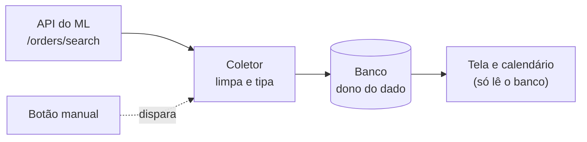

# Checkpoint — Histórico de Vendas e Calendário de Vendas

## Última atualização

**12/10/2026, 04:51.** Registrados os **3 ajustes da lista nova de vendas** feitos depois de Matheus ver a tela no navegador (fotos, cartão do anúncio no formato do Hub e layout fixo): entrada nova na linha do tempo, parágrafo do resumo do estado, linhas "Tela sem SKU" e "Estado" da tabela de regras, "Em aberto" e "Feito". Os achados e o coletor **não mudaram**. **12/10/2026, 04:14.** Registrada a **lista nova de vendas** (substitui a tela sem SKU): entrada nova na linha do tempo, resumo do estado, linha de "Estado" e linha "Tela sem SKU" da tabela de regras, "Em aberto", "Feito" e "Relacionado"; 3 notas novas (decisão, dúvida e tutorial). Os achados e o coletor **não mudaram**. **12/10/2026, 02:41.** Atualizados: o **resumo do estado**, a **linha do tempo** (3 entradas novas: 503 na renovação do token e retry, validação na API real e recoleta com foto, decisão de congelar o coletor), os pontos 5, 7 e 11 dos achados (com os pontos novos 13 e 14) e as listas **"Em aberto"** e **"Feito"**. **Dois erros que estavam aqui foram corrigidos:** (1) o "Último ano" começa em **13/10/2025** em 12/10/2026 (a entrada de 01:35 dizia 12/10/2025); (2) a coleta do ano de 11/10/2026 **teve 3 respostas 429**, não "nenhuma". **12/10/2026, 01:35:** a folga de 1 dia na borda de 12 meses foi aplicada. **12/10/2026, 01:15:** resumo, achados 4 a 12 e "Em aberto" atualizados. As partes de 10/10/2026 e de 11/10/2026 até 22:00 da linha do tempo ficaram como estavam (histórico). Os detalhes de cada achado moram nas notas listadas em "Relacionado".

## Resumo do estado atual

O objetivo é saber o **ritmo de vendas** de cada produto (para depois prever ruptura de estoque e pedidos de compra), começando por uma **tela com calendário de vendas**. O primeiro caminho (endpoint de operações do Full) foi **abandonado** em 10/10/2026 (429 já com 1 SKU; a necessidade é de mais de mil). O caminho atual é o `/orders/search`: o coletor `coletar_vendas_ml.py` grava em `VendaItemMercadoLivre` por **dois caminhos** (por produto e **conta toda**, dia a dia) e a tela "Vendas — Histórico de vendas" lê só do banco; a separação Full × fora do Full está resolvida (11/10/2026).

Em 12/10/2026 a coleta foi **medida** (ano da conta toda: 84.510 pedidos, 1.870 chamadas, 15 min 44 s; 1 SKU de teste: 364 chamadas) e **investigada**: a hora 0 era lida em dobro, a ordem do ML é por `date_closed` (com empates), e o ML corta o começo do dia mais antigo. O coletor foi **corrigido** (`to = fim − 1 hora` e releitura automática) e a correção do `to` foi **validada na API real** (conta MB): o dia 08/07 (200 pedidos, 4 chamadas), o último mês (4.674 pedidos, 110 chamadas) e o último ano (83.049 pedidos, 1.837 chamadas, 15 min 27 s) **fecham com o banco**. Uma recoleta do ano com foto do banco recuperou **1 pedido perdido** pela coleta antiga (19/11/2025) e não deixou nenhuma linha para trás. A coleta começa **1 dia depois** do limite de 12 meses (folga de 1 dia, aplicada às 01:35; em 12/10/2026 o 1º dia é 13/10/2025). A releitura automática **nunca rodou** na API real, porque nenhuma janela deixou de fechar. Às 02:41 Matheus decidiu **não mexer mais no coletor por enquanto**.

Às **04:14** a tela "Vendas — Histórico de vendas" **sem SKU** deixou de ser busca + "Mais vendidos" e virou uma **lista por Produto (SKU), Anúncio (MLB) ou Código ML**, com Full × fora do Full, média por dia e "vs. anterior"; clicar numa linha abre o calendário do produto. Ela lê **só do banco** (4 consultas) e usa a cobertura da **conta toda**. Está **aplicada no código** e verificada num banco de teste. Às **04:51**, depois de Matheus ver a tela no navegador, foram feitos 3 ajustes (fotos, anúncio no formato do cartão do Estoque no Full e layout fixo, que não muda quando a barra lateral abre ou fecha); **falta ele testar no banco real**: [[Substituir a Tela Sem SKU de Vendas por uma Lista por Produto Anuncio e Codigo ML]].

> [!warning] Status: em andamento
> Pedidos da conta MB: **validados, confiança alta**. A coleta de vendas como um todo **ainda não está fechada**: faltam a releitura (nunca exercitada), a conta SV, a conferência com o ERP (terça, 13/10), o conteúdo dos campos, a estabilidade no tempo, pedidos com mais de 1 item e o retry real do token ([[O Que Falta para Considerar Fechada a Validacao da Coleta de Vendas]]). Também faltam resolver os **3 MLBs com vendas fora da tabela de anúncios** e **massificar** para ~1.000 SKUs. Decisões: [[Enviar o to do Orders Search Uma Hora Antes e Reler a Janela Que Nao Fechou]] (correção) e [[Nao Mexer no Coletor de Vendas por Enquanto]].

## Objetivo e regras do trabalho

| Item | O que foi decidido |
|---|---|
| Foco | 100% em **análise de vendas** (estoque e ruptura ficam para depois) |
| Unidade | **1 produto = 1 SKU**, somando as vendas de **todos** os seus MLBs e Códigos ML (variações fora por ora). SKU de teste: `F7908050719121.001` (Códigos `OPXW24140`, `QAVX18725`, `RWBD51502`) |
| 5 níveis da tela | (1) Produto; (2) Produto no Full; (3) Produto fora do Full; (4) por MLB; (5) por Código ML |
| Tela de referência | Cartões-resumo + **calendário de vendas** em matriz semana × dia da semana, "ainda melhor" que a imagem de referência |
| Dado nasce em 1 lugar | API → serviço que limpa e tipa → banco → objeto dono → tela. Evitar JSON; não guardar dado cru da API no banco |
| Cancelada | Venda cancelada **não** conta no dia da venda original (comprou 05/10, cancelou 10/10: o dia 05/10 não tem essa venda). Histórico **líquido por dia da venda** |
| Tela | Nunca chama a API sozinha; só por botão manual |
| Tela sem SKU (12/10/2026 04:14) | **Lista** por Produto (SKU), Anúncio (MLB) ou Código ML, com período, filtros, ordem e paginação; a linha leva ao calendário do produto. Substitui a busca + "Mais vendidos". Às 04:51: fotos corrigidas, anúncio (MLB) no formato do cartão do Estoque no Full e **layout fixo** (a disposição depende só da largura da janela, nunca da barra lateral aberta ou fechada): [[Substituir a Tela Sem SKU de Vendas por uma Lista por Produto Anuncio e Codigo ML]] |
| Estado (12/10/2026) | Tela em uso (período até 365 dias), lendo só do banco; coleta por produto e da conta toda; validando os dados antes de massificar; lista nova sem SKU aplicada às 04:14 e ajustada às 04:51, falta testar no banco real |

## Linha do tempo

### 10/10/2026 — abertura e investigação por pedidos
- Escolhido o primeiro passo: ver as vendas de **1 MLB** (`MLB5838465508`, conta MB) nas janelas de 24 h, 3, 7, 15, 30 e 90 dias via `/orders/search`.
- Fatos reais: 78 pedidos em 90 dias, em 2 páginas; paginação por `offset` funcionou; não foi preciso dividir por dia; todo pedido veio com o MLB. Script: `investigar_vendas_de_1_mlb_por_janela.py`; resultado: `investigacao_vendas_MLB5838465508_MB.json`.
- Preocupação do Matheus: descobrir a logística de cada venda com 1 chamada por pedido "ia explodir a quantidade de chamadas" → buscar o caminho barato para separar Full × fora do Full.

### 10/10/2026 — caminho das operações do Full (Passos 2 a 4)
- **Passo 2**: script `investigar_vendas_full_por_codigo.py` (operações do Full por Código).
- **Passo 3**: tabelas `OperacaoFullMercadoLivre` e `CoberturaOperacaoFullMercadoLivre` (migração `0035`).
- **Passo 4**: coletor API → banco e comando manual `coletar_operacoes_full` (janelas de 46 dias, 4 tipos por janela, espera de 60 s depois de 429 esgotado, cobertura por Código com margem de segurança de 7 dias, opção `--dias`).
- **Sondagem (18:33 a 18:38)** e **3 rodadas reais (19:43 a 19:46)**: 429 em boa parte das chamadas, 404 em scroll repetido. Detalhes: [[Endpoint de Operacoes do Full Falha com 429 e 404 de Scroll Mesmo com 1 SKU]].
- **90 dias validados** na API real (3061 operações, 1 min 40 s, cobertura 12/07 a 11/10/2026). 120 e 150 dias **não** foram testados (Ctrl+C durante a espera).

### 10/10/2026, 20:04 — mudança de rumo
- Decisão de Matheus: **não usar** o endpoint de operações (problema com 1 SKU; necessidade de mais de mil SKUs; sem contato possível com o Mercado Livre agora). Código mantido e comentado.
- Pergunta dele: com o `/orders/search`, dá para ir a 6 ou 12 meses? E esse endpoint é o que gera o calendário?

### 11/10/2026 — separação Full × fora do Full resolvida
- A regra provisória (nó começando por `BRP` = fora do Full) errava para `BRPE01` e `BRPR01`, que são centros do Full; e 338 un do produto de teste vinham "Sem origem informada" (Coleta de antes de 26/03/2026, que o Mercado Livre mandava sem `stock`).
- 60 envios reais conferidos (30 fora do Full, 30 Full): a regra nova acertou 60 de 60. Fatos: [[Envios Reais Confirmam o node_id do Pedido Como Origem da Venda do Full e do Fora do Full]].
- Regra de 4 passos aplicada na tela de vendas, sem chamada nova à API e sem migração: [[Classificar Venda do Full e Fora do Full Pelo node_id do Pedido em 4 Passos]]. No produto de teste: Full 15.440 un (95%), fora do Full 856 (5%), sem origem 10.

### 11/10/2026, 22:00 — tela comparada com a Magiic
- Tela de vendas (conta MB, SKU de teste, 11/07 a 11/10/2026) comparada com o Radar de Vendas e o Relatório de Elasticidade da Magiic, com um script só de banco (nenhuma chamada à API).
- **Unidades e pedidos batem** (no máximo 1 pedido de diferença por anúncio e janela, por causa da fronteira entre janelas). O nosso faturamento (preço do item × quantidade) é igual ao "Preço médio × unidades" da própria Magiic; só o "Vendas R$" dela passa disso, cerca de R$ 4.076 (0,36%). Fatos: [[Radar e Elasticidade da Magiic Confirmam as Unidades e os Pedidos do Historico de Vendas]].
- Sobrou uma pergunta sem pressa: o que é esse acréscimo do "Vendas R$" da Magiic. Ver [[Origem do Acrescimo no Faturamento da Magiic Sobre o Preco do Item]].
- Full × fora do Full não dá para validar na Magiic; continua valendo a validação dos 60 envios.

### 11/10/2026, 23:17 — ano da conta toda coletado
- "Coletar período da conta" de 11/10/2025 a 11/10/2026: **84.510 pedidos, 1.870 chamadas, 15 min 44 s**, com **3 respostas 429** absorvidas pela repetição (23:30:05, 23:30:07 e 23:30:11; o texto antigo dizia "sem nenhum 429", corrigido às 02:41); 2 avisos (só o texto de 1 sobreviveu: 08/07, "anunciou 202, vieram 201"). A semana (04/10 a 11/10) custou 29 chamadas em 14 s; o SKU de teste, por produto, 364 chamadas em 60 s. Medidas e comparação dos dois caminhos: [[Medidas da Coleta de Vendas e Comparacao Entre os Dois Caminhos]].

### 12/10/2026, madrugada — contador de chamadas e investigação das diferenças
- **Decisão de Matheus:** o total exato de chamadas de cada clique fica numa tabela própria (`ExecucaoColetaVendasMercadoLivre`), sem admin; e todos os avisos da coleta passam a ser guardados: [[Guardar o Total de Chamadas de Cada Clique em Tabela Propria no Banco]].
- **A conta não fechava** (leu 84.510, banco 83.438). Script só de banco: a diferença era a **hora 0 do dia seguinte lida em dobro** (previsão e observado batem: semana −19/−19; SKU 42 de 42 trechos; ano −1.073/−1.072, sobra +1, explicada às 02:41 por 2 pedidos que a coleta antiga perdeu). Confirmado na API real (24/11/2025: 477 = 465 + 12; com `to` = 23:00, 465): [[O Filtro de Hora do Orders Search Le a Hora Inteira e Faz a Coleta Ler a Hora 0 Duas Vezes]].
- **O `sort=date_desc` ordena por `date_closed`**, não por criação (20 pedidos, 0 pares fora de ordem): [[O sort date_desc do Orders Search Ordena por date_closed e Nao por Data de Criacao]].
- **Empate de `date_closed` na fronteira da página** repete um pedido e perde outro: reproduzido em 2 de 4 repetições no par de 08/07/2026 (o aviso "202 × 201"); 4 de 365 dias têm esse risco: [[Empate de date_closed na Fronteira da Pagina Repete um Pedido e Perde Outro no Orders Search]].
- **Borda de 12 meses:** o dia mais antigo (11/10/2025) vem parcial (ML 196 × banco 197; o pedido das 03:45:38 é cortado); a coleta não o perdeu: [[O Orders Search Corta o Comeco do Dia Mais Antigo na Borda de 12 Meses]].
- **Os dois caminhos concordam;** a conta toda vê **121 pedidos do SKU de teste em 3 MLBs fora da tabela de anúncios** (127 un): [[Tres MLBs com Vendas do SKU de Teste Nao Estao na Tabela de Anuncios]].
- **Correções aplicadas no coletor** por pedido de Matheus ("corrija o que tiver que corrigir"): `to = fim − 1 hora` com trava de hora cheia, e releitura automática com páginas de 45 e 40. Testadas só numa simulação: [[Enviar o to do Orders Search Uma Hora Antes e Reler a Janela Que Nao Fechou]].
- **Scripts de exploração novos** (todos em `scripts_exploracao_ML/`; os 3 últimos foram rodados por Matheus às 01:14–01:15): `conferir_coleta_da_conta_toda_contra_coleta_por_produto.py` (só banco), `investigar_diferencas_entre_coletas_so_no_banco.py` (só banco), `conferir_filtro_de_hora_do_orders_search.py` (2 chamadas), `conferir_ordem_do_sort_do_orders_search.py` (1 chamada), `investigar_empates_de_fechamento_nas_paginas_so_no_banco.py` (só banco), `conferir_borda_de_12_meses_do_orders_search.py` (3 chamadas), `conferir_reproducao_do_empate_na_api.py` (8 chamadas).

### 12/10/2026, 01:35 — folga de 1 dia na borda aplicada
- Por pedido de Matheus ("pode aplicar"), `FOLGA_DO_LIMITE_ML_DIAS` passou de 0 para 1 em `cobertura_vendas_ml.py`. O "Último ano" começa em **13/10/2025** (o texto de 01:35 dizia 12/10/2025, corrigido às 02:41; o 12/10/2025 vinha inteiro no ML, mas fica fora por segurança) com o aviso "limite do ML" na tela; comentários corrigidos em `cobertura_vendas_ml.py` e `coletar_vendas_ml.py`; cabeçalho do script de borda com o resultado. Nada foi recoletado e o ML real não foi chamado nesta etapa. Detalhes: [[O Orders Search Corta o Comeco do Dia Mais Antigo na Borda de 12 Meses]].

### 12/10/2026, depois das 01:35 — 503 na renovação do token e retry
- Ao clicar em "Atualizar dia" (08/07/2026), a renovação do token da conta MB recebeu **503** do ML e o código mandou "refazer a autorização" (a tela devolveu erro 500; nada foi coletado e o `.env` não mudou).
- Por pedido de Matheus ("pode aplicar, mas comece com um delay de 10s"), a renovação passou a **repetir até 3 vezes** (esperas de 10 s e 20 s) em 5xx, 408, 429 e erro de rede, com a trava mantida viva; 400 e 401 continuam sendo recusa de verdade. Teste simulado (11 cenários) e `teste_conexao.py` na API real (HTTP 200). Detalhes: [[Repetir a Renovacao do Token Quando o Mercado Livre Esta Instavel]].

### 12/10/2026, até cerca de 02:30 — validação na API real e recoleta do ano com foto
- **"Atualizar dia" 08/07/2026:** 200 pedidos, 4 chamadas, sem aviso. **Último mês** (12/09 a 12/10): 4.674 pedidos, 110 chamadas, 55 s. Os dois fecham com o banco: [[Coleta Corrigida Validada na API Real Fecha com o Banco e a Conta de Chamadas Bate]].
- `CORRECAO_DA_HORA_0_APLICADA_EM` preenchida com `(2026, 10, 12, 1, 40)` no script de diferenças.
- **Matheus perguntou se deveria apagar o banco antes de recoletar o ano:** decidido **não apagar** e tirar uma **foto** antes (script novo `foto_do_banco_de_vendas_ml.py`): [[Nao Apagar o Banco Antes de Recoletar o Ano e Tirar uma Foto Dele Antes]].
- **Foto às 02:07:45** (83.447 itens, 88.269 unidades, 367 dias) e **recoleta do ano às 02:10:31** (13/10/2025 a 12/10/2026, 365 dias): **83.049 pedidos, 1.837 chamadas, 15 min 27 s**; fecha com o banco e a conta de chamadas bate (1.835 páginas mais 2 repetições por 429).
- **Comparação:** o banco foi de 83.447 para 83.449 itens: **1 pedido de 19/11/2025 recuperado** (perdido pela coleta antiga; fechado no mesmo segundo que outro) e 1 venda nova; 0 linhas sumidas, 0 não tocadas; as 400 linhas de 11 e 12/10/2025 ficam fora da janela. [[Recoleta do Ano com Foto do Banco Recuperou 1 Pedido Perdido por Empate e Nao Perdeu Nenhuma Linha]].

### 12/10/2026, 02:41 — pergunta "100% válida?" e decisão de congelar o coletor
- Resposta à pergunta de Matheus ("podemos considerar 100% válida e fechada as coletas sobre informações de vendas?"): **ainda não 100%**; pedidos da MB validados com confiança alta e 7 itens por validar: [[O Que Falta para Considerar Fechada a Validacao da Coleta de Vendas]].
- **Decisão de Matheus:** "não vamos mais ficar mudando esse script por enquanto, está bom da forma que está". Interpretação registrada: o coletor (e os scripts de verificação e de foto) ficam como estão: [[Nao Mexer no Coletor de Vendas por Enquanto]]. Registro feito no vault com esta data e hora.

### 12/10/2026, 04:14 — lista nova de vendas substitui a tela sem SKU
- **Pedido de Matheus:** uma lista granular de vendas por **Produto (SKU)**, **Anúncio (MLB)** e **Código ML**, "igual fizemos para o estoque no Full". Ele esclareceu que a tela nova **substitui** a tela antiga sem SKU (busca + "Mais vendidos"); o calendário por SKU continua, aberto ao clicar numa linha.
- Ele aprovou o mockup (feito como artefato), disse "pode aplicar ao código" e preferiu os **4 ciclos de uma só vez**. Aplicado direto na pasta do projeto, sem git e sem cópias; os testes e as migrações são dele.
- **O que mudou:** `lista_vendas_ml.py` (novo, cálculo da lista), `vendas_ml.py` (sem SKU devolve a lista; removidas a busca e o "Mais vendidos" antigos), 2 parciais de template novas, `script_vendas_lista.js` novo, CSS `vnd-l-*` novo e um script de conferência. O coletor **não foi tocado**.
- **Regras:** as mesmas da tela do produto (cancelada não conta, `classificar_origem`, `codigo_do_item`, ausente não é zero, "vs. anterior" só com o período anterior completo, ±10%). **Interpretações minhas** (ele pode mudar): cobertura da **conta toda**, linha "Sem cadastro", "Sem Código ML" limitado a 60 anúncios com venda, 25 linhas por página.
- **Verificado** num banco de teste: as 3 visões somam o mesmo total que a soma direta e a lista bate com a tela do produto em 4 SKUs. **Não** rodado no banco real nem visto no navegador.
- **Achado do código:** um pedido sem `seller_sku` de um MLB que serve a mais de um SKU conta nos dois SKUs na tela do produto e vai para "Sem cadastro" na lista: [[MLB Compartilhado por Mais de um SKU e Vendido Sem seller_sku Pode Dar Numero Diferente na Lista e na Tela do Produto]].
- Notas: [[Substituir a Tela Sem SKU de Vendas por uma Lista por Produto Anuncio e Codigo ML]] e [[Tutorial - Como Testar a Lista de Vendas e Conferir Contra a Tela do Produto]]. Registro feito no vault com esta data e hora (informadas por Matheus).

### 12/10/2026, 04:51 — ajustes da lista nova depois de Matheus ver a tela
- Matheus abriu a lista no navegador e mandou capturas. Três pedidos, aplicados direto na pasta do projeto (sem git e sem cópias): (1) "cadê as fotos?"; (2) "quero os anúncios neste formato" (o cartão do Estoque no Full, o Hub); (3) "as coisas precisam ser fixas na tela, não podem ficar mudando de posição aleatoriamente porque a nav bar abriu".
- **Fotos:** a função `_url_segura` trocava `http` por `https` no endereço da foto do produto (vindo do ERP); passou a ser usado o endereço **como está** (`_url_da_foto`), e uma foto que falhe vira um **ícone**. A causa é a **mais provável, não confirmada** no banco dele.
- **Cartão do anúncio:** o MLB usa o estilo compartilhado `.cartao-anuncio-*` e os selos do registro único (`badges.py`): foto, selos, título (com copiar), MLB, SKU e Código ML. Aparece na visão por MLB e dentro de SKU e Código ML. Continuam **4 consultas** (foto, link e selos saem da consulta de cadastro que já existia).
- **Layout fixo:** os filtros em chips, os cartões de resumo e o rodapé quebravam de linha conforme a largura que sobrava ao lado da barra lateral. Regra nova: a **disposição só depende da largura da janela**, nunca da barra. Cada grupo de filtro ficou na sua linha, os cartões em 5 ou 3 colunas fixas, a tabela com largura mínima de 1500 px (rola para o lado quando falta espaço). Medido num Chromium de teste em 6 larguras (2560 a 1280 px), barra aberta × fechada: posições e alturas **iguais** (antes havia diferença em 1600 e 1366 px). Dados e fonte do teste não são os dele.
- Notas: [[Substituir a Tela Sem SKU de Vendas por uma Lista por Produto Anuncio e Codigo ML]] (seção "Ajustes depois de ele ver a tela no navegador") e [[Tutorial - Como Testar a Lista de Vendas e Conferir Contra a Tela do Produto]]. Registro feito no vault com esta data e hora (informadas por Matheus).

## Achados sobre o calendário e o `/orders/search`

**O que a doc de Orders diz** (`Fontes/Orders.txt`):
- Pedidos são guardados por até **12 meses**.
- Busca como vendedor **filtra pedidos cancelados** (a confirmar com dado real).
- Filtros úteis: `seller`, `order.date_created.from/to`, `order.date_closed.from/to`, `order.date_last_updated.from/to`, `order.status`, `item`, `q`, `tags`; ordenação com `sort=date_desc`.
- Resposta com `paging`: `total`, `offset`, `limit` (exemplo com 50).
- O filtro de data **usa até a hora** e descarta minutos, segundos e milissegundos.

**O que isso significa para o calendário:**
1. **Quem gera o calendário é o banco**, não o endpoint: o `/orders/search` alimenta o banco pelo coletor, e a tela soma por dia a partir dele.
2. Cada pedido traz `date_created`, `seller_sku`, o MLB (`order_items[].item.id`) e a quantidade. **Produto (SKU)** e **por MLB** saem direto do pedido. **Por Código ML** deve sair pelo MLB, com a ligação que o sistema já tem (a confirmar). **Produto no Full / fora do Full** dependem da separação Full × fora do Full, resolvida em 11/10/2026 em [[Classificar Venda do Full e Fora do Full Pelo node_id do Pedido em 4 Passos]] (a dúvida original: [[Campo stock node_id do Pedido Separa Venda do Full de Venda Fora do Full]]).
3. **Fuso:** a data do pedido vem com `-04:00` (ex.: `2026-10-10T08:27:04.000-04:00`). O dia da venda do calendário deve ser calculado em **horário de São Paulo** (`America/Sao_Paulo`), senão uma venda perto da meia-noite cai no dia errado.
4. **Dia da venda** = `date_created` (criação do pedido) ou `date_closed` (confirmação)? Na amostra a diferença foi de 4 segundos; só pesa perto da meia-noite. **Decisão do Matheus pendente.** *Atualização (12/10/2026):* hoje o coletor usa `date_created` (dia da venda em Brasília), que é também o campo do filtro de data; já o `sort=date_desc` ordena por `date_closed`, e a diferença entre os dois pode ser de **dias** (um pedido criado em 24/11/2025 às 12:44 foi fechado em 27/11 às 19:06).
5. **6 ou 12 meses:** a doc limita a **12 meses** e não fixa intervalo máximo por chamada, mas não diz até onde vai o `offset`. Medir o `paging.total` de 7, 30, 90, 180 e 360 dias (1 chamada cada) antes de decidir. Coleta incremental: 90 dias primeiro e estender para trás aos poucos, como no `--dias`. *Atualização (11 e 12/10/2026):* decidido **12 meses** (período máximo da tela: 365 dias) e o ano inteiro da conta foi coletado; o dia mais antigo (11/10/2025) vinha **parcial**; com a folga de 1 dia, o 1º dia coletado em 12/10/2026 é 13/10/2025 e veio inteiro na recoleta ([[O Orders Search Corta o Comeco do Dia Mais Antigo na Borda de 12 Meses]]).
6. **Cancelados:** se a busca como vendedor realmente os filtra, uma venda paga que depois foi cancelada **some** da busca. Falta decidir como o banco percebe isso (reler por `order.date_last_updated`? pedir `order.status=cancelled`?). *Atualização (12/10/2026):* a conferência entre os 2 caminhos de coleta **não achou nenhum cancelado perdido** (o único pedido que só 1 caminho viu estava `paid`); segue por confirmar com dado real.
7. **Cota:** as 10 chamadas a `/orders/search` feitas em 10/10/2026 não deram nenhum 429; é amostra pequena, e a página oficial diz que o limite é por endpoint. *Atualização (12/10/2026):* o limite é de **18.000 requisições por hora por aplicativo**; a coleta do ano (1.870 chamadas em 15 min 44 s, ~2 por segundo) ficou bem abaixo disso, mas teve **3 respostas 429**, cada uma repetida com sucesso na 1ª tentativa (a recoleta do ano de 12/10 teve mais 2); a semana e o SKU de teste não tiveram nenhum ([[Medidas da Coleta de Vendas e Comparacao Entre os Dois Caminhos]]). *(Corrigido às 02:41: o texto anterior dizia "nenhum 429".)*
8. **Filtro de hora:** o `to` lê a hora inteira; a janela do coletor passou a ser `[início, fim)` em horas cheias com `to = fim − 1 hora` ([[O Filtro de Hora do Orders Search Le a Hora Inteira e Faz a Coleta Ler a Hora 0 Duas Vezes]]).
9. **Ordem da lista:** `sort=date_desc` = ordem decrescente de `date_closed` ([[O sort date_desc do Orders Search Ordena por date_closed e Nao por Data de Criacao]]).
10. **Empates:** pedidos fechados no mesmo segundo, na fronteira de página, podem repetir um e perder outro; a releitura com página de outro tamanho protege ([[Empate de date_closed na Fronteira da Pagina Repete um Pedido e Perde Outro no Orders Search]]).
11. **Borda de 12 meses:** o dia mais antigo vem parcial; folga de 1 dia **aplicada em 12/10/2026 01:35**; o 1º dia coletado é 13/10/2025 em 12/10/2026 e será 14/10/2025 em 13/10/2026 ([[O Orders Search Corta o Comeco do Dia Mais Antigo na Borda de 12 Meses]]).
12. **Custo:** o custo da coleta segue os pedidos (~1 chamada a cada 45), não os SKUs; a conta toda é o único caminho que vê MLBs fora do cadastro ([[Medidas da Coleta de Vendas e Comparacao Entre os Dois Caminhos]]).
13. **Validação da correção:** na API real (MB), o dia, o mês e o ano fecham com o banco, e o custo em chamadas é a soma de `ceil(pedidos do dia ÷ 50)` mais as repetições por 429; a releitura nunca rodou ([[Coleta Corrigida Validada na API Real Fecha com o Banco e a Conta de Chamadas Bate]]).
14. **Recoleta com foto do banco:** a recoleta do ano recuperou 1 pedido perdido pela coleta antiga (19/11/2025, empatado em `date_closed`), sem linhas sumidas nem não tocadas; a conta antiga fecha com 2 pedidos perdidos ([[Recoleta do Ano com Foto do Banco Recuperou 1 Pedido Perdido por Empate e Nao Perdeu Nenhuma Linha]]).

## Em aberto

**Validar e corrigir a coleta**
- [ ] Fechar a validação da coleta de vendas: releitura automática (nunca rodou na API real), conta SV, ERP, conteúdo dos campos, estabilidade no tempo, pedidos com mais de 1 item e retry real do token: [[O Que Falta para Considerar Fechada a Validacao da Coleta de Vendas]]. O coletor está **congelado** por decisão de Matheus: [[Nao Mexer no Coletor de Vendas por Enquanto]]
- [ ] Último mês da conta **SV** com o código novo (~100 chamadas), com foto do banco antes e comparação depois
- [ ] (Só se Matheus pedir) teste simulado da releitura, em script separado e sem chamada ao ML
- [ ] Repetir o "Reler tudo" do ano em algumas semanas e comparar com a foto de 12/10/2026 (mede a mudança de situação dos pedidos)
- [ ] Se o 1º dia da tela voltar a vir parcial, subir a folga (hoje 1) e/ou tratar o 1º dia como parcial nas contas de ritmo de venda (não implementado)
- [ ] Hora exata do corte do ML e se ele se move durante o dia: [[Onde Fica o Corte do Orders Search na Borda de 12 Meses e se Ele Muda Durante o Dia]]
- [ ] (Opcional) Melhorar a estimativa do modal da conta toda usando o histórico das coletas da conta toda (hoje erra nos dois sentidos: ano ~1.466 contra 1.837 reais, mês ~127 contra 110; antes, 13 contra 29)
- [ ] (Opcional) Endpoint de pedidos arquivados do ML: **precisa do HTML da doc oficial**; ainda não temos

**Dados e conferências**
- [ ] **Testar a lista nova de vendas** no banco real e rodar o script de conferência; no navegador, conferir os 3 ajustes das 04:51 (fotos, cartão do anúncio e layout igual com a barra lateral aberta e fechada): [[Tutorial - Como Testar a Lista de Vendas e Conferir Contra a Tela do Produto]]
- [ ] Ver se existe MLB que serve a mais de 1 SKU e vendeu sem `seller_sku`; se existir, decidir a regra (lista e tela do produto hoje diferem nesse caso): [[MLB Compartilhado por Mais de um SKU e Vendido Sem seller_sku Pode Dar Numero Diferente na Lista e na Tela do Produto]]
- [ ] 3 MLBs com vendas do SKU de teste fora da tabela de anúncios (121 pedidos; a lista nova de 04:14 mostra, dentro do SKU, o MLB fora do cadastro que traz o `seller_sku` dele, com o selo "Fora do cadastro do SKU", **ainda não conferido no banco real**): [[Tres MLBs com Vendas do SKU de Teste Nao Estao na Tabela de Anuncios]] (e contar, só no banco, quantos MLBs da conta estão nessa situação antes de massificar)
- [ ] Terça 13/10/2026: Matheus baixa do ERP (Sysemp) a planilha de vendas do último ano de 1 SKU, para conferir os números da tela e se a venda foi Full ou comum; depois, script só de banco para comparar
- [ ] Conferir o dia 01/10/2026 (só 88 pedidos; mediana do ano 207) com o ERP
- [ ] Medir a regra de origem na conta SV (`medir_origem_pela_logistica_do_anuncio.py` com `CONTA = "SV"`), conferir `SV_USER_ID` no `.env` e medir a coleta na SV
- [ ] (Sem pressa) Fechar a dúvida do acréscimo do "Vendas R$" da Magiic lendo 1 pedido no Mercado Livre: [[Origem do Acrescimo no Faturamento da Magiic Sobre o Preco do Item]]

**Decisões e produto**
- [ ] Confirmar com Matheus as interpretações da lista nova (cobertura da conta toda, linha "Sem cadastro", "Sem Código ML" limitado a 60, 25 por página): [[Substituir a Tela Sem SKU de Vendas por uma Lista por Produto Anuncio e Codigo ML]]
- [ ] **Massificar** o histórico para ~1.000 SKUs: decidir como puxar (a conta toda é o caminho principal; custo em [[Medidas da Coleta de Vendas e Comparacao Entre os Dois Caminhos]])
- [ ] Decidir `date_created` × `date_closed` para o dia da venda (hoje: `date_created`)
- [ ] Confirmar a ligação MLB → Código ML para o nível 5
- [ ] Decidir o destino das tabelas do Passo 3 (`OperacaoFull...`)
- [ ] Decidir se o `seller_id` real deve ser mascarado no log `full_ml.log` (pergunta feita ao Matheus, sem resposta)
- [ ] Migrar `/items?ids=` para `/items/bulk?ids=` antes de 25/10/2026
- [ ] `window.innerWidth` de um computador da empresa (Matheus consegue em ~2 dias a partir de 11/10) para decidir a largura mínima do calendário
- [ ] Mais adiante: ponte com o JSON do Planejamento; ler da API o máximo de Códigos por chamada e a omissão do `type` só se o endpoint de operações voltar a ser considerado

**Feito**
- [x] Rodar o script de exploração do `/orders/search` (10/10/2026) e decidir 6 ou 12 meses: **12 meses** (período máximo da tela: 365 dias)
- [x] Resolver a dúvida do `node_id` (níveis 2 e 3): [[Classificar Venda do Full e Fora do Full Pelo node_id do Pedido em 4 Passos]]
- [x] Desenhar o coletor de pedidos (cobertura por conta e período) e a tela com botão manual lendo só do banco
- [x] Guardar o total de chamadas de cada clique: [[Guardar o Total de Chamadas de Cada Clique em Tabela Propria no Banco]]
- [x] Explicar a diferença entre as coletas (hora 0 em dobro) e a ordem do ML (`date_closed`, empates)
- [x] Aplicar `FOLGA_DO_LIMITE_ML_DIAS = 1` (12/10/2026 01:35): [[O Orders Search Corta o Comeco do Dia Mais Antigo na Borda de 12 Meses]]
- [x] Validar o `to = fim − 1 hora` na API real (12/10/2026): dia 08/07, mês e ano fecham com o banco: [[Coleta Corrigida Validada na API Real Fecha com o Banco e a Conta de Chamadas Bate]]
- [x] Preencher `CORRECAO_DA_HORA_0_APLICADA_EM` com `(2026, 10, 12, 1, 40)`
- [x] Tirar a foto do banco e recoletar o ano sem apagar nada: [[Nao Apagar o Banco Antes de Recoletar o Ano e Tirar uma Foto Dele Antes]] e [[Recoleta do Ano com Foto do Banco Recuperou 1 Pedido Perdido por Empate e Nao Perdeu Nenhuma Linha]]
- [x] Renovação do token com repetição quando o ML está instável (503): [[Repetir a Renovacao do Token Quando o Mercado Livre Esta Instavel]]
- [x] Explicar o 2º aviso da coleta antiga: provavelmente 19/11/2025 (pedido recuperado; texto do aviso perdido, **não provado**)
- [x] Registrar a decisão de congelar o coletor (12/10/2026 02:41): [[Nao Mexer no Coletor de Vendas por Enquanto]]
- [x] Aplicar no código a lista nova de vendas por SKU, MLB e Código ML, no lugar da tela sem SKU, com script de conferência (12/10/2026 04:14; **falta ele testar**): [[Substituir a Tela Sem SKU de Vendas por uma Lista por Produto Anuncio e Codigo ML]]
- [x] Ajustar a lista depois de ele ver a tela: fotos, anúncio no formato do cartão do Estoque no Full e layout fixo com a barra lateral aberta ou fechada (12/10/2026 04:51; **falta ele conferir**): [[Substituir a Tela Sem SKU de Vendas por uma Lista por Produto Anuncio e Codigo ML]]

## Relacionado

- [[Endpoint de Operacoes do Full Falha com 429 e 404 de Scroll Mesmo com 1 SKU]]
- [[Abandonar o Endpoint de Operacoes do Full para o Historico de Vendas]]
- [[Campo stock node_id do Pedido Separa Venda do Full de Venda Fora do Full]]
- [[Niveis de Granularidade do Full e Como os Dados se Ligam]]
- [[Padrao de Robustez para Clientes de API Externa]]
- [[Classificar Venda do Full e Fora do Full Pelo node_id do Pedido em 4 Passos]]
- [[Envios Reais Confirmam o node_id do Pedido Como Origem da Venda do Full e do Fora do Full]]
- [[Radar e Elasticidade da Magiic Confirmam as Unidades e os Pedidos do Historico de Vendas]]
- [[Origem do Acrescimo no Faturamento da Magiic Sobre o Preco do Item]]
- [[O Filtro de Hora do Orders Search Le a Hora Inteira e Faz a Coleta Ler a Hora 0 Duas Vezes]]
- [[O sort date_desc do Orders Search Ordena por date_closed e Nao por Data de Criacao]]
- [[Empate de date_closed na Fronteira da Pagina Repete um Pedido e Perde Outro no Orders Search]]
- [[O Orders Search Corta o Comeco do Dia Mais Antigo na Borda de 12 Meses]]
- [[Medidas da Coleta de Vendas e Comparacao Entre os Dois Caminhos]]
- [[Guardar o Total de Chamadas de Cada Clique em Tabela Propria no Banco]]
- [[Enviar o to do Orders Search Uma Hora Antes e Reler a Janela Que Nao Fechou]]
- [[Onde Fica o Corte do Orders Search na Borda de 12 Meses e se Ele Muda Durante o Dia]]
- [[Tres MLBs com Vendas do SKU de Teste Nao Estao na Tabela de Anuncios]]
- [[Coleta Corrigida Validada na API Real Fecha com o Banco e a Conta de Chamadas Bate]]
- [[Recoleta do Ano com Foto do Banco Recuperou 1 Pedido Perdido por Empate e Nao Perdeu Nenhuma Linha]]
- [[Nao Apagar o Banco Antes de Recoletar o Ano e Tirar uma Foto Dele Antes]]
- [[Nao Mexer no Coletor de Vendas por Enquanto]]
- [[O Que Falta para Considerar Fechada a Validacao da Coleta de Vendas]]
- [[Repetir a Renovacao do Token Quando o Mercado Livre Esta Instavel]]
- [[Substituir a Tela Sem SKU de Vendas por uma Lista por Produto Anuncio e Codigo ML]]
- [[MLB Compartilhado por Mais de um SKU e Vendido Sem seller_sku Pode Dar Numero Diferente na Lista e na Tela do Produto]]
- [[Tutorial - Como Testar a Lista de Vendas e Conferir Contra a Tela do Produto]]
