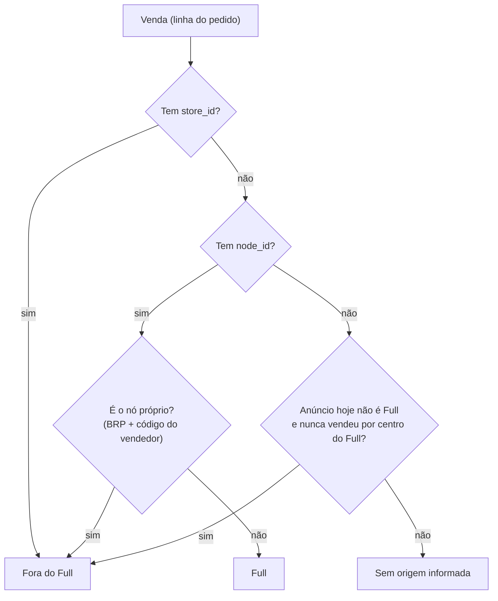

# Classificar Venda do Full e Fora do Full Pelo node_id do Pedido em 4 Passos

## Resumo

Em 11/10/2026, Matheus aprovou a regra que a tela "Vendas — Histórico de vendas" usa para dizer se cada venda saiu do **Full** ou de **fora do Full**: loja (`store_id`) ou nó de estoque próprio (`BRP` + código do vendedor) = fora do Full; qualquer outro nó = Full; sem nó e sem loja = fora do Full só se o anúncio hoje não é Full e nunca vendeu por centro do Full, senão "Sem origem informada". Tudo é calculado com dado que já está no banco: **nenhuma chamada nova à API do Mercado Livre**.

> [!success] Status: concluída (11/10/2026)
> Regra decidida, aplicada na tela e conferida por 60 envios reais (60 de 60 acertos, fatos em [[Envios Reais Confirmam o node_id do Pedido Como Origem da Venda do Full e do Fora do Full]]). No produto de teste, a tela passou de **Full 83,5% / fora do Full 14,4% / sem origem 2,1%** para **Full 95% / fora do Full 5% / sem origem 0%** (15.440 / 856 / 10 unidades, de 16.306). Esta decisão responde a dúvida [[Campo stock node_id do Pedido Separa Venda do Full de Venda Fora do Full]].

## Contexto

A tela de histórico de vendas mostra as vendas de **1 produto (1 SKU)** em 5 níveis: Produto, No Full, Fora do Full, Por MLB e Por Código ML (ver [[Checkpoint - Historico de Vendas e Calendario de Vendas]]). Os níveis "No Full" e "Fora do Full" só funcionam se cada venda tiver a origem certa.

Termos usados aqui, na primeira aparição:

| Termo | O que é |
|---|---|
| **Full** (`fulfillment`) | O Mercado Livre guarda o produto num centro de distribuição dele, embala e envia. |
| **Coleta** (`cross_docking`) | O Mercado Livre coleta o produto no barracão da empresa. Por regra de negócio do Matheus, Coleta é **obrigatoriamente "fora do Full"**. |
| **Agência** (`xd_drop_off`) e **Flex** (`self_service`) | Outras formas de envio que também saem do estoque da empresa, não do Full. |
| **Nó** (`node_id`) | O "lugar" de onde o item saiu: um centro do Full (ex.: `BRSP11`) ou um depósito do vendedor. Vem no pedido, em `order_items[].stock.node_id`. |
| **Loja** (`store_id`) | Código do depósito do vendedor. Só vem preenchido quando o estoque saiu do depósito do próprio vendedor. |
| **`logistic.type`** | O tipo de logística do **envio** (`GET /shipments/{id}`): é a resposta oficial de "foi Full ou não". |

A regra de negócio de preços do vault é binária: `fulfillment` = Full, qualquer outro tipo = não-Full (ver [[Grade de Precificacao ML Usa Apenas FULL vs Nao-FULL, Nunca os 7 Tipos Logisticos Separados]]). A tela de vendas segue a mesma lógica.

## A pergunta

Qual regra, usando **só o que já está no banco**, diz com segurança se cada venda é Full ou fora do Full? A restrição vem do Matheus: ele tem quase 1 mil SKUs, "o que funcionar para 1 SKU deve funcionar para todos", e não pode fazer milhares de chamadas à API — o mínimo possível sempre.

## O que levou à decisão

**1. A regra provisória estava errada em dois pontos.** Até 11/10/2026 a tela dizia: `store_id` preenchido ou nó começando por `BRP` = fora do Full; outro nó = Full; sem nó = sem origem. Ela vinha de uma amostra de 20 envios. Medindo o produto de teste inteiro (conta MB, 11/10/2025 a 11/10/2026, 16.293 unidades), apareceram dois problemas:

| Problema | Tamanho | Causa |
|---|---|---|
| Venda de centro do Full contada como "fora do Full" | **1.824 un** (`BRPE01` 1.335 + `BRPR01` 489), em todos os meses | `BRPE01` e `BRPR01` começam com `BRP`, mas são **centros do Full**. O prefixo `BRP` sozinho não identifica o nó próprio. |
| Venda "Sem origem informada" | **338 un**, de 16/10/2025 a 25/03/2026 | Nessa época o Mercado Livre mandava o pedido de Coleta **sem** o bloco `stock`. Não é falha do coletor. |

**2. Alternativas.**

| Caminho | O que seria | Por que foi descartado ou escolhido |
|---|---|---|
| **A. 1 chamada a `/shipments` por pedido** | Perguntar ao envio de cada venda qual é o `logistic.type` | **Descartado por Matheus.** Só para as vendas sem origem seriam ~330 chamadas; o produto tem 16.266 pedidos no ano; vezes quase 1 mil SKUs. |
| **B. Manter o prefixo `BRP`** | Nó começando por `BRP` = fora do Full | **Descartado.** `BRPE01` e `BRPR01` deram `fulfillment` em 10 de 10 envios conferidos. |
| **C. Usar só os selos do anúncio (logística e "Com Flex")** | Classificar pela logística que o anúncio tem hoje | **Descartado como regra geral.** O selo diz como o anúncio está **hoje**, não como estava no dia da venda, e o selo "Com Flex" aparece nos 17 anúncios do produto, então não separa nada. Fica só como último recurso (passo 4). |
| **D. Regra de 4 passos com nó, loja e, no último caso, a logística do anúncio** | A regra abaixo | **Escolhida.** Zero chamada à API, mesma regra para qualquer SKU. |

**3. A conferência.** Matheus duvidou de que o produto vendesse só ~855 unidades por ano fora do Full e pediu para confirmar a regra com envios reais: **60 envios, 30 que a regra manda para fora do Full e 30 para o Full**. Resultado: 60 de 60 confirmaram (detalhes em [[Envios Reais Confirmam o node_id do Pedido Como Origem da Venda do Full e do Fora do Full]]).

## Decisão

A função `classificar_origem` decide, **na ordem**:

| Passo | Condição da venda | Resultado | Por quê |
|---|---|---|---|
| 1 | Tem `store_id` | **Fora do Full** | O estoque saiu do depósito do vendedor. |
| 2 | Tem `node_id` do **nó próprio** (`BRP` + código do vendedor) | **Fora do Full** | É o estoque do vendedor (envio `cross_docking` em 15 de 15 testados). |
| 3 | Tem **qualquer outro** `node_id` | **Full** | É um centro do Full (envio `fulfillment` em 30 de 30 testados, incluindo `BRPE01` e `BRPR01`). |
| 4 | Não tem `node_id` nem `store_id` | **Fora do Full**, **só se** o anúncio hoje não é Full **e** esse MLB nunca vendeu por centro do Full; senão **"Sem origem informada"** | Antes de 26/03/2026 o Mercado Livre mandava a Coleta sem `stock` (envio `cross_docking` em 15 de 15 testados). O que não passa nesse teste continua sem origem, **sem chute**. |

**Detalhes que importam:**

- O **nó próprio** é `BRP` + o código do vendedor (o `user_id` da conta) + `1`. O código vem do `.env` (`MB_USER_ID` ou `SV_USER_ID`, a mesma variável que a API já usa). A regra testa `BRP` + código, **nunca só `BRP`**. Em notas, o nó próprio é escrito mascarado (`BRP***1`): o código do vendedor não vai para o vault.
- O passo 4 olha o **histórico inteiro** do MLB no banco (sem cancelados), não só o período da tela, para a mesma venda ter a mesma origem em qualquer período.
- A origem **não fica gravada** no banco: a tela calcula a cada abertura a partir de `node_id`, `store_id` e da logística do anúncio. Por isso **não precisa de migração nem de reler/recoletar as vendas**.

**Onde está no código** (projeto `Projeto_Sistema_Interno_V2`):

| Arquivo | O que mudou |
|---|---|
| `gestao_vendas/funcoes_auxiliares/vendas_ml.py` | `classificar_origem` (os 4 passos), `prefixo_do_no_proprio`, `_codigo_do_vendedor` (lê `{MB\|SV}_USER_ID`), `_mlbs_fora_pela_logistica` (passo 4) e `_anotar` (aplica a regra a cada linha) |
| `gestao_vendas/templates/gestao_vendas/estrutura_vendas.html` | A legenda embaixo da tabela "Por origem" descreve a regra nova |
| `mercado_livre/models/venda_item.py` | Só o comentário do campo `node_id` (sem mudança de banco) |

> [!warning] Sem `MB_USER_ID` (ou `SV_USER_ID`) no `.env`, a tela dá erro de propósito
> Sem o código do vendedor não dá para reconhecer o nó próprio, e classificar errado em silêncio é pior do que avisar. O servidor novo (GCP) precisa dessa linha no `.env`, como a API do Mercado Livre já exige.

## Exemplo

Produto de teste (SKU `F7908050719121.001`, conta MB, 11/10/2025 a 11/10/2026):

| Origem | Regra antiga | Regra nova (medida no script) | Tela depois da mudança |
|---|---|---|---|
| No Full | 13.606 un (83,5%) | 15.430 un (94,7%) | 15.440 un (95%) |
| Fora do Full | 2.349 un (14,4%) | 853 un (5,2%) | 856 un (5%) |
| Sem origem informada | 338 un (2,1%) | 10 un (0,1%) | 10 un (0%) |
| Total | 16.293 un | 16.293 un | 16.306 un |

A diferença de 13 unidades entre a medição e a tela é de vendas novas coletadas depois (a soma da tela fecha: 15.440 + 856 + 10 = 16.306).

Caso concreto: um pedido com nó `BRPE01` era contado como "fora do Full"; agora é **Full**, porque o envio dele é `fulfillment`. Um pedido com nó `BRP***1` continua **fora do Full**, porque o envio é `cross_docking`.

## Limites e o que falta

- **Nenhum envio de Flex (`self_service`) apareceu** nos 80 envios conferidos (20 de 10/10/2026 e 60 de 11/10/2026). Se um dia aparecer Flex saindo de um centro do Full, o passo 3 precisa mudar, e só esta função muda (`classificar_origem`).
- **Só a conta MB foi medida.** Para a SV, rodar `medir_origem_pela_logistica_do_anuncio.py` com `CONTA = "SV"` e conferir.
- **O passo 4 depende da logística de hoje do anúncio.** As vendas sem origem conhecidas são de 16/10/2025 a 25/03/2026; se um anúncio mudar de logística, só essas vendas antigas são afetadas.

## Relacionado

- [[Campo stock node_id do Pedido Separa Venda do Full de Venda Fora do Full]] — a dúvida que esta decisão resolve.
- [[Envios Reais Confirmam o node_id do Pedido Como Origem da Venda do Full e do Fora do Full]] — os fatos medidos nos envios.
- [[Abandonar o Endpoint de Operacoes do Full para o Historico de Vendas]] — por que o caminho é o `/orders/search` e não o endpoint de operações.
- [[Checkpoint - Historico de Vendas e Calendario de Vendas]] — onde está o trabalho da frente de histórico de vendas.
- [[Grade de Precificacao ML Usa Apenas FULL vs Nao-FULL, Nunca os 7 Tipos Logisticos Separados]] — a regra binária Full × não-Full do vault.
